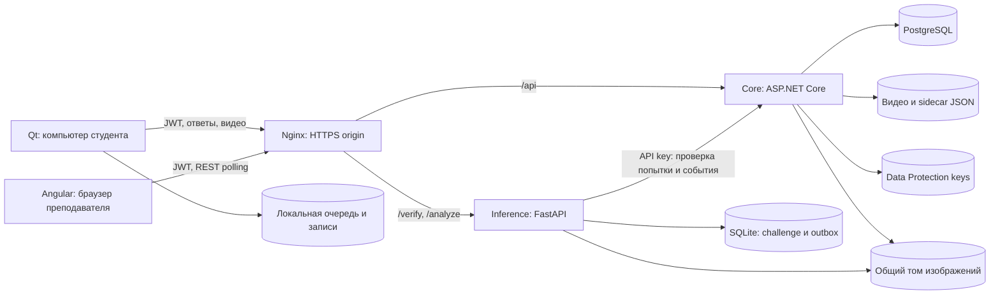

# ExamGuardian: аудит архитектуры и безопасности

Дата: **26 октября 2026**. Основа: рабочая копия поверх `8c20e548afdd5d0d696189d8e3ef0312c8cfbe15`, включая существующие незакоммиченные и новые файлы. Статус: отчет для планирования исправлений; прикладной код в рамках аудита не изменялся.

## 1. Вывод и порядок действий

Разделение на Qt-клиент, Core, Inference и Angular оправдано. Рекомендую сохранить стек и развивать **модульный Core с отдельным AI-процессом**. Переписывание на другой язык, дробление Core на микросервисы или внедрение Kubernetes сейчас увеличат стоимость изменений без устранения основных дефектов.

Основные риски находятся в жизненном цикле эталонных фотографий, модели полномочий преподавателя, управлении учетными данными, ресурсных ограничениях и согласованности доказательств между файловой системой и БД. Для контролируемого пилота база уже существенно лучше первоначального прототипа. Для открытого эксплуатационного контура сначала следует закрыть P1 и определить обязательные правила мониторинга.

Начать предлагаю с **R01 → R02 → R03 → R04/R05 → R06/R07**, затем исправить доказательства и эксплуатацию. У каждого пункта ниже есть проверяемый результат; их можно превращать в отдельные задачи/PR без большого переписывания.

**Приоритеты:** P1 — исправить до внешней эксплуатации или многопользовательского пилота; P2 — следующий этап надежности и защиты; P3 — поддерживаемость/оптимизация. Подтвержденного анонимного удаленного захвата сервера уровня P0 в этой проверке не установлено. Это не утверждение об отсутствии таких уязвимостей.

**Достоверность:** «воспроизведено» означает локальную изолированную проверку; «код» — непосредственно прослеживаемый путь в исходниках; «риск» — условный сценарий, требующий дополнительного испытания. Приоритет риска зависит от указанного условия.

## 2. Объем и ограничения

Проверены основные потоки и границы доверия во всех подсистемах: Core (контроллеры, авторизация, сервисы, EF-модель, миграции и обслуживание), Inference (JWT, challenge, анализ, очередь, модели), Qt (настройка сервера, авторизация, очередь загрузки, ограничения среды), Angular (токены, interceptor, мониторинг и отчеты), Docker/Nginx, запуск, backup, упаковка релизов, CI, Landing и сайт документации. Старый `PROJECT_ANALYSIS.md` использован как исторический контекст, а не как описание текущих дефектов.

Это обзор всего проекта с углублением в критические пути, а не доказательство проверки каждой строки, каждого бинарного файла или каждой транзитивной зависимости. Фактическая конфигурация рабочего сервера, firewall, права на тома и содержимое секретов не исследовались. Не выполнялись нагрузочная атака, изменение рабочей БД, пересоздание рабочих контейнеров, реальная сдача экзамена с устройствами, проверка биометрической точности и полный аудит CVE/истории Git. Исполняемые релизы проверены на подпись, но не подвергались реверс-инжинирингу.

### Выполненная проверка

| Проверка | Результат и границы |
|---|---|
| `dotnet build Core/Core.sln --configuration Release --no-restore` | Успех, 0 ошибок, 5 предупреждений: имена старых миграций и неиспользованный параметр AdmissionValidator. Это сборка с уже восстановленными зависимостями. |
| `Inference/venv/Scripts/python.exe -m unittest discover -s tests -v` из Inference | **45 тестов прошли**. Проверяется логика/контракты с подменами моделей; точность реальной биометрии не доказывается. |
| Первоначальный запуск Python из PATH | Не прошел: в Anaconda отсутствуют FastAPI/OpenCV. Повтор в имеющемся `Inference/venv` успешен; первоначальные ошибки не считаются дефектом приложения. |
| `python -m unittest discover -s tests -p test_linux_launcher.py -v` | **4 теста прошли**, subprocess подменяется; это не запуск Linux-клиента. |
| `npm.cmd run build` из monitor | Успех. Initial bundle 604,32 kB при бюджете 500 kB; предупреждения размеров трех CSS и устаревших данных baseline-browser-mapping. |
| `npm.cmd test -- --watch=false --browsers=ChromeHeadless` из monitor | **38 тестов прошли**, Chrome Headless. |
| Изолированный вызов настоящего `get_challenge` | Воспроизведено удаление использованного reference при очистке просроченного challenge, см. R01. Временная SQLite, фиктивные изображения, без моделей и рабочей БД. |
| Authenticode установщика Prod | `Landing/ExamGuardian_Setup_Prod.exe`: **NotSigned**. |

Интеграционные Core/PostgreSQL-контракты, сборка Qt и восстановление из backup в этом аудите не запускались. Наличие этих проверок в CI не равнозначно успешному прогону текущей рабочей копии.

## 3. Фактическая архитектура

Core — источник истины для владельца, расписания, попыток, ответов, баллов и решения преподавателя. Inference выдает допуск и наблюдения. Qt поставляет кадры, звук, видео и телеметрию, но работает на устройстве, которым может управлять сам экзаменуемый. Angular показывает состояние и инициирует решения; его guards не являются серверной защитой.

Важные границы доверия:

1. **Устройство студента → сервер.** Подписанный сервером токен подтверждает право запроса, но не происхождение кадров с физической камеры и не подлинность клиентского бинарника.
2. **Преподаватель → данные других преподавателей/студентов.** Для экзаменов есть ownership, для справочника студентов и паролей граница значительно шире.
3. **Inference → Core.** AI обрабатывает недоверенные медиа, но одновременно получает общий ключ подписи пользовательских JWT.
4. **БД → файлы → SQLite.** Это три независимых механизма фиксации данных; транзакция PostgreSQL не откатывает записи в файловую систему.
5. **Production → development.** Compile-time и runtime ограничения DEV есть, однако клиентский протокол и локальные проверки не являются аттестацией устройства.

### Что уже реализовано правильно

- AI проверяет подпись, срок, issuer, audience и роль JWT; permissive fallback из старого аудита отсутствует.
- StudentId на старте берется из аутентифицированного пользователя, балл рассчитывается сервером из снимка вопросов.
- Есть отдельные audience для admission/attempt/evidence, привязка токенов к пользователю, попытке и lease; при resume сменяется ActiveClientId.
- Есть серверный deadline, сохранение ответов, блокировки PostgreSQL, уникальная активная попытка на пару студент/экзамен.
- Чанки имеют SHA-256, неизменяемый индекс, проверку контейнера/длительности и повторяемую доставку. Это защита передачи, а не аттестация записи.
- AI использует SQLite outbox, EventId обеспечивает дедупликацию в Core; ошибка доставки не просто теряется в background task.
- Академический балл отделен от integrity verdict; принятие требует доставленных записей и снятых наблюдений, отклонение — подтвержденного наблюдения.
- QTI запрещает DTD/XML resolver, ограничивает XML/ZIP и проверяет пути. CSV учетных данных экранирует формулы.
- DEV-допуск отдельно подписан, выключается сборкой/настройкой, DEV-попытки исключаются из подтвержденного экспорта.
- Production-профиль включает TLS; dev/prod используют разные проекты; CI уже содержит Core, Angular, Inference и Qt Linux. Нельзя описывать проект как «без тестов».

## 4. Реестр проблем

| ID | Приоритет | Область | Суть | Основание |
|---|---|---|---|---|
| R01 | P1 | Биометрия | Очистка challenge удаляет reference активной попытки | Воспроизведено |
| R02 | P1 | Пользователи | Endpoint удаления студента может удалить Examiner | Код |
| R03 | P1* | Полномочия | Любой Examiner получает/перевыпускает пароли любой группы | Код; *если преподаватели не глобальные администраторы |
| R04 | P1 | Доступность | Нет лимитов попыток входа и частоты challenge | Код конфигурации |
| R05 | P1 | Хранилище | Нет совокупной квоты загрузки доказательств | Код; нагрузка не измерена |
| R06 | P1 | Криптография | AI получает ключ подписи всех пользовательских JWT | Код; последствия при компрометации AI |
| R07 | P1 | Учетные сессии | Долгий access JWT не отзывается; refresh хранится открыто | Код |
| R08 | P1* | Достоверность | Delivered и Accepted не требуют истории покрытия AI/аудио | Код; *если мониторинг обязателен |
| R09 | P1 | Целостность | Падение между записью файлов и commit оставляет несогласованность | Код; crash-тест нужен |
| R10 | P2 | Биометрия | Силу проверки выбирает клиентский protocol | Код |
| R11 | P1 | Транспорт | Production-клиент допускает произвольный HTTP origin | Код |
| R12 | P1 | Пароли | Восстановимые пароли и ключи попадают в один backup | Код |
| R13 | P2 | Браузер/медиа | JWT в localStorage, URL-capability может попасть в access log | Код; XSS/утечка не доказаны |
| R14 | P2 | События | Не сохраняется доверенный источник наблюдения | Код |
| R15 | P2 | Отчеты | Исторический состав группы зависит от текущего профиля | Код |
| R16 | P2 | Архитектура | Правила доступа и переходов распределены между слоями | Код |
| R17 | P2 | Масштабирование | Полные выборки, локальные очереди, блокирующие операции | Код; предел нагрузки неизвестен |
| R18 | P1 | Восстановление | Backup не выбирает новые dev/prod-профили | Код, подтверждено README |
| R19 | P2 | Жизненный цикл данных | Нет полного удаления фото, сирот и локальных секретов | Код |
| R20 | P2 | Поставка | Prod-установщик не подписан; hardening контейнеров неполон | Воспроизведено/код |
| R21 | P2 | Эксплуатация | Неполные аудит действий, диагностика и контроль зависимостей | Код |

## 5. Подробности и критерии исправления

### R01. Reference живет меньше экзамена

**Где:** [создание/очистка challenge][S01], [периодическое сравнение][S02], [сохранение AdmissionId][S03].

Challenge имеет срок 240 секунд. При создании следующего challenge удаляются записи с `expires < now - 300` и соответствующие `references/<id>.jpg`, включая `used=1`. Но AdmissionId активной попытки остается этим id, и `/analyze/frame` продолжает читать тот же файл. Примерно через девять минут от создания challenge любой новый challenge может удалить нужный эталон. При resume старый AdmissionId тоже обычно сохраняется.

**Последствие:** нормальный участник получает `identity_uncertain/reference_missing`, и непрерывное сравнение личности перестает работать. Это не доказанная возможность пройти чужую биометрию; это подтвержденный дефект жизненного цикла эталона.

**Проверка:** настоящий `get_challenge` вызван в тестовом окружении; использованный challenge искусственно состарен, затем создан challenge другого пользователя. Получено `reference_before=True`, `reference_after=False`. Активный Core не поднимался; связь с ним прослежена по AdmissionId/InternalController/frame.py.

**Исправление:** отделить временный challenge reference от закрепленного attempt reference. Core должен подтверждать перевод reference в состояние «используется попыткой»; удалять его только по жизненному циклу этой попытки. Повторный вход и истечение challenge не должны влиять на эталон текущей попытки.

**Приемка:** экзамен длительностью 60 минут, новые challenge других участников, restart AI и resume не удаляют эталон; неиспользованные challenge очищаются; retention завершенной попытки удаляет закрепленный reference.

### R02. Удаление пользователя не проверяет роль цели

**Где:** [StudentsController.Delete][S04], [UserService.DeleteAsync][S05].

Endpoint требует роль Examiner у вызывающего, но `DeleteAsync(id)` загружает произвольный User по GUID и удаляет его без `Role == Student`. Аналогичный общий GetById применяется при работе с фотографией. Ограничения FK могут запретить удаление преподавателя с экзаменами, но не защищают преподавателя без связанных записей. Собственный GUID доступен из JWT, поэтому возможно как минимум удаление собственной учетной записи через ошибочный endpoint.

**Исправление:** запросить цель сразу с `Role == Student`; управление преподавателями вынести в отдельную административную операцию. Запретить удаление последнего администратора, если появится такая роль. Предпочесть деактивацию записей с историей.

**Приемка:** DELETE с GUID преподавателя, включая собственный и преподавателя без экзаменов, возвращает 404/403 и не меняет БД. Для фото и GetById также проверяется тип цели.

### R03. Examiner фактически администрирует весь студенческий справочник

**Где:** [GroupCredentialsController][S06], [GroupCredentialsService][S07], [StudentsController][S04], [GroupsController][S08].

Любой Examiner может перечислить студентов/группы, загрузить PDF с сохраненными паролями любой группы, перевыпустить их и менять фото/группу студентов. В сервис выгрузки не передается вызывающий пользователь. Ownership экзаменов этого не предотвращает.

**Условие:** если Examiner по продуктовой модели действительно глобальный доверенный администратор учреждения, это сознательная широкая роль, а не обход задуманной политики. Если это обычный преподаватель, риск высокий: доступ к чужим учетным данным и вмешательство в чужие экзамены.

**Исправление:** определить роли Administrator, Registrar, Examiner и назначения на группы/экзамены. Право управлять enrollment и выдавать учетные данные отделить от просмотра экзамена. Для одной организации достаточно таблицы назначений; tenant-модель нужна только при реальной поддержке нескольких организаций.

**Приемка:** два независимых преподавателя и две группы; чужие фото, PDF паролей, reset, импорт и перевод группы запрещены сервером; административные исключения явно покрыты тестами и журналируются.

### R04. Нет защиты от массовых login/challenge-запросов

**Где:** [AuthService][S09], [Program][S10], [Nginx TLS][S11], [get_challenge][S01].

В просмотренной конфигурации нет rate limiting ни на входе, ни в Core. BCrypt проверяется на каждый подходящий login. Авторизованный студент может создавать множество challenge: каждый пишет SQLite и копирует фото; создание не ограничивается одним актуальным challenge на пользователя. CapacityGate ограничивает отдельные анализаторы, но не заменяет лимит запросов и создание challenge.

**Исправление:** лимиты по IP и учетной записи для login/refresh, по пользователю/экзамену для challenge, ограничение активных challenge, общий concurrency budget; корректный 429/Retry-After. Сначала настроить доверенные proxy/ForwardedHeaders, иначе все пользователи могут оказаться под одним IP Nginx. Не использовать бессрочную блокировку аккаунта, которую легко вызвать постороннему.

**Приемка:** серия неправильных паролей и частых challenge ограничивается; другой участник продолжает работать; память, временные файлы и SQLite не растут без границы.

### R05. Лимит одного чанка не является квотой попытки

**Где:** [UploadChunk/FinalizeEvidence][S12], [Nginx][S11].

Разрешены два потока, до 2048 индексов на поток и 128 MiB на файл. Формальный верхний объем — **512 GiB на одну попытку** до дополнительных ограничений среды. Видео проверяется, но нет бюджетов суммарных байтов, темпа загрузки, временного диска и длительности относительно окна экзамена. Несколько параллельных запросов могут заполнить temp еще до ffprobe; semaphore ffprobe ограничивает процессы, но не весь прием запросов.

**Исправление:** квота по попытке/пользователю, потоковый лимит фактически прочитанных байтов, допустимый диапазон offset относительно экзамена, ограничение входящих upload и свободного диска. Проверять диапазоны по серверной политике, сохранив возможность догрузки после окончания.

**Приемка:** превышение квоты возвращает предсказуемую ошибку до исчерпания диска; принятые записи и ответы других студентов доступны; метрики показывают использование/резерв.

### R06. Общий HMAC-ключ разрушает изоляцию Core и AI

**Где:** [compose.base.yml][S13], [AI JWT/admission][S01], [AttemptTokens][S14], [MediaLinkSigner][S15].

Один JWT key используется для access JWT, admission, attempt/evidence и ссылок на медиа; этот ключ передается AI. Если атакующий получает выполнение кода/секреты в AI, он способен подписать JWT роли Examiner для Core, а не только подделать наблюдение. Компрометация AI в этом аудите не демонстрировалась.

**Исправление:** Core подписывает access/attempt приватным ключом, AI получает только публичный ключ проверки. Для admission — отдельная пара AI→Core с отдельным issuer/audience и ограниченными claims. Отдельный секрет медиа; отдельные service credentials для callback. Добавить kid и процедуру ротации.

**Приемка:** секреты AI не позволяют создать принимаемый Core Examiner JWT или media capability; старые/чужие audience и ключи отклоняются; штатная ротация не теряет экзамен.

### R07. Отзыв доступа и refresh-сессии неполны

**Где:** [AuthService][S09], [AuthController][S16], [IssuedCredentials][S17], [JWT validation][S10].

Access JWT по умолчанию живет 1440 минут. Logout и перевыпуск пароля сбрасывают refresh, но не ранее выданный access. JWT middleware не проверяет security stamp, активность/существование пользователя. RefreshToken хранится в User в исходном виде, по одному на пользователя. При параллельном refresh оба запроса могут прочитать старое значение и выдать access JWT; нет атомарного consume, token family и детектирования reuse. Последний login также вытесняет refresh предыдущего устройства.

**Исправление:** короткий access TTL с надежным refresh, серверная версия безопасности/отзыв по session id, отдельная таблица RefreshSession с хешем случайного токена, сроком, устройством и атомарной ротацией. Продумать offline/повторный refresh Qt, а не просто сократить TTL.

**Приемка:** после reset/logout/deactivate защищенные операции прекращаются в объявленный срок; два конкурентных refresh не создают две действующие цепочки; дамп БД не содержит пригодных refresh-секретов; экзамен корректно переживает обновление токена.

### R08. Полнота файлов не равна полноте мониторинга

**Где:** [FinalizeEvidence][S12], [ReviewSessionAsync][S18], [VideoInspector][S19], [InternalController][S20].

Delivered проверяет последовательность чанков и временное покрытие по метаданным клиента. ffprobe проверяет наличие видеотрека, но не обязательный аудиотрек, реальную полезность изображения или соответствие записанной камеры отправленным AI кадрам. Accepted требует Delivered и снятия наблюдений, но не историю покрытия AI; LastAnalysisAt/LastAudioAt — только последние отметки.

**Сценарий:** после штатного допуска модифицированный клиент не вызывает анализ или посылает его выборочно, продолжая отправлять видео. Серверный predicate принятия сам по себе не отличит такой случай. Решение преподавателя все еще требуется; автоматического Accepted студент не получает.

**Исправление:** в снимке политики определить обязательные каналы и допустимые пропуски; хранить временные интервалы приема/анализа, тип/версию модели, статус качества и причину разрыва. Для обязательного звука проверять аудиотрек. Разрешение ручного принятия при техническом сбое оформлять отдельным исключением с причиной, а не скрывать сбой.

**Приемка:** отсутствие AI 10 минут, отсутствие аудиотрека и крупные разрывы отображаются в архиве и не проходят стандартное принятие. Результат не должен называться гарантией подлинности физической камеры: пользовательский ПК остается недоверенным.

### R09. Файлы и PostgreSQL фиксируются независимо

**Где:** [UploadChunk][S12].

Файл и sidecar перемещаются в финальные пути до SaveChanges/CommitAsync. При падении после записи обоих файлов, но до commit, прежний verdict/статус остается в БД. При повторе `newChunk=false` и `newMetadata=false`, поэтому блок сброса verdict может уже не выполняться. Особенно важно для поздних материалов после ранее принятой попытки. Возможны также orphan-файлы и неполное удаление при retention.

**Исправление:** реестр EvidenceChunk в БД с unique(session, stream, index), хешем и состоянием Pending/Stored/Verified; запись через staging и повторяемый finalize. Повтор upload должен восстанавливать инварианты БД независимо от факта наличия файла. Нужен reconciler для файлов без реестра/реестра без файла.

**Приемка:** fault injection на каждом шаге записи/commit; повтор восстанавливает состояние, конфликт содержимого не перезаписывается, позднее доказательство всегда отменяет устаревшее подтверждение. Выполнять на временной БД и storage.

### R10. Протокол клиента выбирает вариант биометрии

**Где:** [get_challenge][S01], `Inference/tests/test_security.py`.

`None`, 2 и 3 намеренно получают визуальные задачи без произнесения фразы; protocol 4 включает речь только при доступной модели. Admission не фиксирует достигнутый уровень проверки/протокол для контроля Core. Это документированная совместимость, но она становится обходом политики, если организация считает речь обязательной.

**Исправление:** серверная versioned admission policy: минимальный протокол, обязательные факторы, режим fallback. Передавать достигнутые факторы в подписанном proof и сохранять их в попытке.

**Приемка:** при обязательной речи старый protocol/недоступная модель дают явный отказ или разрешенное исключение с отметкой; при необязательной — совместимость остается.

### R11. Нативный production-клиент не требует HTTPS

**Где:** [configureServer][S21], [clientServerUrl][S22].

Одинаково принимаются схемы HTTP и HTTPS, production default — `http://localhost`; EXAMGUARDIAN_URL читается напрямую. При ручной настройке удаленного HTTP пароли и bearer-токены могут уйти незашифрованными. Redirect на стороне официального production Nginx не является универсальной защитой: первый запрос уже мог содержать секрет.

**Исправление:** централизованная проверка origin перед любым сетевым запросом; HTTPS в production, узкое исключение loopback только для dev; то же правило для env override. Ошибки сертификата не игнорировать.

**Приемка:** удаленный HTTP отклоняется до отправки login; HTTPS с недоверенным сертификатом отклоняется; production/development покрыты отдельными тестами.

### R12. Повторная выгрузка паролей требует более сильной защиты ключей

**Где:** [IssuedCredentials][S17], [DataProtection registration][S10], [Backup][S23].

Выданные пароли зашифрованы отдельно от BCrypt, но ключи сохраняются через PersistKeysToFileSystem без явного ProtectKeysWith*. Backup копирует БД и key ring вместе в обычный каталог. Следовательно, доступ к такому backup дает возможность восстановить выданные пароли. При явной настройке файлового key storage автоматическое шифрование ключей at rest отключается — это прямо описано в [документации Microsoft](https://learn.microsoft.com/en-us/aspnet/core/security/data-protection/implementation/key-storage-providers?view=aspnetcore-10.0).

**Исправление:** сначала решить, обязательна ли постоянная повторная выдача исходного пароля. Предпочтительный вариант — одноразовая выдача/активация и управляемый reset. Если функция сохраняется: шифровать key ring независимым ключом/сертификатом, разграничить доступ, шифровать backup и не хранить ключ расшифровки рядом, журналировать выгрузки. Data Protection не заменяет ACL и управление секретами.

**Приемка:** копии БД и backup без отдельного ключа недостаточно для восстановления паролей; потеря/ротация ключа отработаны на восстановлении; обычный Examiner не получает массовую выгрузку без отдельного права.

### R13. Секреты браузера и подписанные ссылки нуждаются в ограничении утечек

**Где:** [AuthService Angular][S24], [MediaLinkSigner][S15], [GetChunk][S12], [Nginx TLS][S11].

Access JWT хранится в localStorage; успешный same-origin XSS смог бы его прочитать. Сам XSS в этом аудите не найден. В Nginx нет CSP/HSTS в просмотренном конфиге. Видео доступно по короткой bearer-ссылке без сессии браузера — это предусмотренная capability, а не само по себе IDOR. Но подпись в query может сохраняться стандартным access log и пересылаться получателем до истечения срока; logout ее не отзывает.

**Исправление:** access token в памяти с HttpOnly refresh либо BFF-cookie с CSRF-защитой; CSP сначала в report-only. Для ссылок — redaction query в логах, no-store для чувствительных ответов, минимальный TTL и при необходимости отдельная отзывная media-сессия. HSTS включать после проверки рабочего HTTPS-домена.

**Приемка:** журналы не содержат bearer-подписей; CSP совместима с Angular; expiry/отзыв media проверены; закрытый origin не получает Authorization через interceptor (текущую защиту сохранить).

### R14. Клиентские и AI-наблюдения не имеют надежно различимого источника

**Где:** [ViolationsController.ReportClientViolation][S25], [ViolationAlertService][S26].

Студент может отправить произвольный ViolationType/Confidence/Metadata в своей попытке; сервер очищает EvidenceUrl, но не назначает отдельный Source и не ограничивает типы клиентским allowlist. В сущности и DTO источник события не отделен от текста, который контролирует отправитель. Это позволяет загрязнить собственную историю и неоднозначно представить клиентское сообщение как AI-сигнал. Массовая отправка также повышает нагрузку и переводит verdict в UnderReview.

**Исправление:** серверные Source=Client/Inference/System, allowlist для каждого канала, schema metadata по типу события, serverReceivedAt и claimedCapturedAt отдельно; источник показывать в UI. Дополнить лимитами R04/R05.

**Приемка:** клиент не может создать событие с доверенным Source=Inference; невалидный тип/metadata отклоняется; повторный EventId остается идемпотентным.

### R15. Исторические отчеты меняются при переводе студента

**Где:** [GroupResultsService.Build][S27], [GradeExportService][S28], [GroupsController][S08].

Группа хранится строкой в User, состав выбирается текущий. Перевод после экзамена меняет положение/наличие участника в старой ведомости и каталоге экспорта. Этот предел уже честно указан в README, но для академического архива он существенен. Название группы используется как идентификатор, связи User.Group/Exam.AllowedGroup не являются полноценными membership FK.

**Исправление:** GroupId, Membership с периодом действия, ExamAssignment/ExamRoster и снимок группы/идентификатора участника в попытке. Явно разделить «текущий список группы» и «состав экзамена на дату проведения».

**Приемка:** перенос/переименование группы не меняет выпущенную историческую ведомость; текущий справочник показывает новое положение; миграция legacy-строк сохраняет смысл старых результатов.

### R16. Архитектурные слои не задают единую границу бизнес-правил

**Где:** [ExamSessionService][S18], [SessionAccess][S29], [VideoUploadController][S12], [GroupCredentialsService][S07].

Есть BLL/DAL и repository/unit-of-work, но сервисы одновременно используют DbContext напрямую, контроллеры содержат бизнес-транзакции и filesystem-логику, проверки доступа находятся и в controller, и в SessionAccess. Объект ExamSession объединяет выполнение, оценивание, evidence, review и JSON-историю. String-статусы и неверсированные JSON-снимки увеличивают риск неодинаковых правил. Например, Criteria Accepted, критерии PDF и критерии Moodle export реализованы в разных местах.

**Исправление:** модульный монолит: Identity/Enrollment, ExamCatalog, Attempts/Grading, Evidence, Review/Reporting. Application handlers получают ActorContext и проверяют права сами. Общие policy-функции определяют переходы и export eligibility. Контроллеры только преобразуют HTTP; storage скрыт за интерфейсом. Выбрать DbContext как unit-of-work или действительно нужные репозитории, убрать лишнюю обертку и runtime casts. Версионировать snapshots и типизировать состояния.

**Приемка:** API, deadline worker и фоновые задачи вызывают одинаковые use cases; обойти проверку доступа прямым вызовом сервиса нельзя; существующие HTTP-контракты сохраняются при рефакторинге.

### R17. Масштабирование требует измерений и изменения модели чтения

**Где:** [Details/GetByIdsAsync][S18], [Inference dependencies][S30], [outbox][S31], [readiness][S32], [DeadlineWorker][S33].

Списки сессий материализуют Student/Exam/все Violations и SavedAnswers, затем подсчитывают агрегаты в памяти. Нет server-side pagination на ключевых списках; polling повторяет передачу истории. В AI очереди ограничены внутри одного процесса; SQLite/тома и файловые preview создают локальную связанность. Общие анализаторы используются разными gate; lock MediaPipe есть, поэтому утверждать отсутствие синхронизации у всех моделей неверно. Реальная concurrency-safe работа остальных shared-моделей требует отдельной проверки.

Readiness AI всегда возвращает `ready: true`, включая backlog; dead events только отмечают degraded, не дают готового операторского workflow. DeadlineWorker обрабатывает до 50 попыток последовательно; исключение одной прерывает оставшуюся итерацию, и плохая запись может повторно мешать другим.

**Исправление:** отдельные краткие DTO списков и SQL-проекции/счетчики, cursor pagination и delta polling. Измерить p95, queue age и пропускную способность на целевом числе участников. Отделить liveness/readiness/degraded и alerting; ошибки deadline изолировать на запись с продолжением batch. До нескольких AI workers определить владение состоянием и распределение попыток; брокер/Redis добавлять по измеренной необходимости.

**Приемка:** согласованное число одновременных студентов проходит нагрузочный профиль; медленный AI не блокирует ответы Core; один поврежденный snapshot не мешает завершить остальные; backlog/dead letters видны оператору и безопасно повторяются.

### R18. Backup не охватывает выбранный новый профиль автоматически

**Где:** [Backup.ps1][S23], [launcher][S34], README, `scripts/Restore-Checkpoint.ps1`.

Launcher использует `examguardian-dev`/`examguardian-production` и compose overlays; backup вызывает голый `docker compose` с legacy defaults. Он может завершиться ошибкой либо сохранить другой старый проект. Последовательный pg_dump/copy/SQLite backup не образует общую транзакцию. README предупреждает о quiet checkpoint, но скрипт не обеспечивает остановку записи/drain.

**Исправление:** единый объект DeploymentProfile для запуска/backup/restore, явные project/env/config/db, идентификатор окружения в manifest. Maintenance режим с запретом новых попыток и завершением доставки либо согласованные storage snapshots; проверки completeness. Установить RPO/RTO, зашифрованное внешнее хранение и регулярный restore drill.

**Приемка:** при одновременно работающих dev и prod backup выбранного профиля содержит только его данные; восстановление на чистом окружении показывает ответы, медиа, ключи и корректный статус очередей. Успешный pg_dump сам по себе не считается успешным восстановлением системы.

### R19. Retention не охватывает весь жизненный цикл персональных данных

**Где:** [RetentionMaintenance][S35], [удаление User][S05], [локальная очередь Qt][S36].

Retention выключен по умолчанию и удаляет медиа только завершенных уже рассмотренных попыток. Нерассмотренные попытки могут накапливаться без срока. Удаление студента не удаляет enrollment `<id>.jpg`; выдаваемые reference, orphan evidence и временные файлы имеют отдельные пути очистки. Qt сохраняет evidence-токены обычным JSON и локальные записи в AppLocalDataLocation; общей политики хранения/доступа к ним нет. Для использования evidence API одного этого токена недостаточно — нужен и access JWT владельца.

**Исправление:** матрица данных и сроков: enrollment, challenge, attempt reference, evidence, transcript, token, backup, локальная очередь; отдельный legal/operational hold без автоматического бесконечного хранения. Очистка сирот по реестру R09, удаление enrollment при согласованной деактивации. Защитить локальные секреты средствами ОС, установить ACL и сроки очистки.

**Приемка:** удаление тестового студента без истории очищает его enrollment; активные ссылки не удаляются; reviewed/unreviewed/hold различаются; сухой прогон объясняет каждый кандидат. Законность сроков/биометрии требует отдельного решения владельца данных, этот отчет не является юридической оценкой.

### R20. Поставка и изоляция контейнеров

**Где:** [сборка клиента][S37], Core/Inference/monitor Dockerfile, [compose][S13], `.github/workflows/verify.yml`.

Проверенный Prod-установщик не имеет Authenticode. SHA-256 manifest полезен для целостности, но при замене установщика вместе с manifest не удостоверяет издателя. Dockerfile Core/Inference не переключают runtime на non-root; compose не задает memory/pids/cpu limits, read-only rootfs, drop capabilities/no-new-privileges. Образы и actions указаны тегами, Python lock без обязательной проверки хешей пакетов; CI не содержит видимого отдельного vulnerability/SBOM gate.

**Исправление:** подписывать production exe/installer и проверять подпись в release job; публиковать артефакты из воспроизводимой сборки. Non-root и минимальные writable volumes, ресурсы контейнеров и контроль временных файлов. Зафиксировать базовые образы/пакеты по digest/hash там, где это практично; добавить SBOM и регулярный dependency audit с разбором достижимости уязвимостей.

**Приемка:** изменение релизного бинарника ломает проверку доверия; процесс приложения не root; модель/ffprobe работают с ограниченными правами; лимиты не ломают штатный экзамен. Наличие конкретной CVE в текущих зависимостях этим отчетом не заявляется.

### R21. Журналирование и операционная диагностика не закрывают все действия

**Где:** [ExamsController][S38], [ViolationsController][S25], [GroupCredentialsService][S07], [DbInitializer][S39], [outbox][S31].

Review history сохраняется, но нет общего audit trail чтения паролей, reset, замены фото, перевода группы и административных выгрузок. Ряд catch возвращает `ex.Message` клиенту, включая общие Exception, что может раскрыть внутренние детали. Миграции выполняются самим приложением при startup — runtime DB-пользователю нужны более широкие права, а обновление схемы связано с доступностью API. Dead outbox остается в SQLite без полноценного management workflow.

**Исправление:** структурированный audit event с actor/action/target/outcome/request id без секретов, централизованный ProblemDetails/error mapping, раздельные migration/runtime DB credentials. Для оператора — метрики диска, возраста очереди, ошибок AI, deadline lag, пропусков мониторинга и restore status. Журнал делать append-only на уровне приложения; дополнительные гарантии против DB-admin вводить только при соответствующей модели угроз.

**Приемка:** чувствительная операция оставляет запись, но пароль/JWT/медиаподпись не попадают в журнал; неожиданный сбой дает correlation id вместо внутреннего exception; старты экземпляров не конкурируют за изменение схемы.

## 6. Целевая архитектура и последовательность миграции

Оставить Core единым deployable, PostgreSQL основной БД, Inference отдельным процессом, Angular и Qt текущими клиентами. Внутри Core ввести ясные модули и правила:

| Модуль | Ответственность | Основные данные |
|---|---|---|
| Identity / Enrollment | Роли, назначения, refresh-сессии, регистрация эталона | User, RefreshSession, Group, Membership, EnrollmentReference |
| ExamCatalog | Версии вопросов, расписание, назначение группе | Exam, ExamVersion, ExamRoster, AdmissionPolicy |
| Attempts / Grading | Серверное время, lease, ответы, финальный балл | Attempt, AnswerRevision, GradingSnapshot |
| Evidence | Загрузка, проверка, квоты, покрытие, retention | EvidenceChunk, CaptureInterval, AnalysisInterval |
| Review / Reporting | Наблюдения, решения, история, экспорт | Observation с Source, ReviewDecision, ExportRecord |

Не обязательно сразу создавать столько таблиц: это границы ответственности. Внедрять по сценарию, сохраняя старый HTTP-контракт через adapters. Нужные изменения данных — отдельными совместимыми миграциями; backfill legacy должен явно отмечать неизвестное, а не придумывать группу/покрытие/биометрический фактор.

Ключевые инварианты целевого решения:

- БД определяет владельца/права/политику; DTO клиента не назначает роль, score или trusted Source.
- Допуск связан с версией политики и закрепленным reference; очистка challenge не затрагивает попытку.
- Наличие записи, полнота каналов, покрытие AI и integrity verdict — разные состояния.
- Любое позднее изменение доказательств создает пересмотр, включая повтор после аварии.
- Исторический результат воспроизводится из снимка, а не из текущего справочника/вопросов.
- Все фоновые операции повторяемы; у отказов есть диагностируемый и безопасный путь повторения.

### Этап 1 — исправления без большой перестройки

- [ ] R01: закрепить attempt reference и regression test очистки/resume.
- [ ] R02: ограничить User endpoints только студентами.
- [ ] R03: утвердить матрицу ролей и закрыть массовые пароли отдельным правом.
- [ ] R04/R05: login/challenge/upload limits, квоты и контроль диска.
- [ ] R11: запрет удаленного HTTP в production Qt.
- [ ] R18: backup/restore с явным выбором профиля; один проверенный restore.

### Этап 2 — модель доверия и доказательства

- [ ] R06/R07/R12: разделить ключи, атомарные refresh-сессии, отзыв доступа, защита backup.
- [ ] R08/R10: серверная политика факторов и обязательных каналов, история покрытия.
- [ ] R09/R14: EvidenceChunk registry, восстановление после crash, trusted event source.
- [ ] R13/R19: безопасность браузерных/локальных секретов и полный data lifecycle.

### Этап 3 — постепенное изменение архитектуры

- [ ] R15: стабильные группы/состав экзамена и миграция истории.
- [ ] R16: общие use cases/policies, тонкие контроллеры, versioned snapshots.
- [ ] R17: краткие read models, pagination, устойчивый deadline worker, нагрузочные измерения.
- [ ] R20/R21: подписанные релизы, hardening, audit events, dependency gates и операционные метрики.

Изменение каждого пункта завершать негативным сценарием, проверкой обычного экзамена и обновлением отчета «открыто/исправлено/принят риск» с commit и результатом теста. Не отмечать архитектурную задачу закрытой только потому, что изменились папки/названия классов.

## 7. Решения, которые нужно принять перед соответствующим этапом

1. **Кто такой Examiner?** Глобальный администратор или преподаватель назначенных групп? Рекомендация: ограниченный преподаватель, enrollment/пароли — Registrar/Admin.
2. **Нужно ли повторно раскрывать исходные пароли?** Рекомендация: выдача/активация один раз и reset; если повторный PDF обязателен, принять стоимость защиты ключей и аудита.
3. **Можно ли принять попытку без AI/звука?** Рекомендация: явно заданная политика экзамена и отдельное мотивированное исключение, а не молчаливое принятие.
4. **Какова модель устройства?** Личный ПК с наблюдением или управляемая аудитория с более сильной защитой? Qt hooks/проверки VM не дают гарантии против администратора компьютера.
5. **Какой размер пилота и SLA?** Зафиксировать число одновременных студентов, требуемые p95, RPO/RTO и retention до выбора очередей/репликации/объектного storage.
6. **Что означает групповая ведомость?** Текущий состав или состав на дату экзамена? Для архива рекомендован зафиксированный экзаменационный roster.

## 8. Дополнительные испытания перед эксплуатацией

| Испытание | Что должно подтвердить |
|---|---|
| Authorization matrix | Student A/B, Examiner A/B, Registrar/Admin; каждый endpoint чтения/изменения/экспорта |
| Concurrent lifecycle | Start/resume/submit/deadline/review/late upload без потери инвариантов |
| Crash/retry | Падение API/AI между storage и commit, повтор запроса, restart, диск заполнен |
| Privacy | Нет секретов в HTTP logs, backup/локальный cache защищены, lifecycle удаления проверен |
| Real media | Камера/звук/экран, permission denied, переключение устройства, sleep/resume, плохая сеть |
| Biometric evaluation | Размеченные реальные участники, освещение, очки, качество камер, replay/deepfake/виртуальная камера; FAR/FRR и ошибки по группам условий |
| Capacity | Одновременный admission и экзамен, p50/p95/p99, CPU/RAM/IO, длина и возраст очереди |
| Disaster recovery | Потеря хоста и восстановление в новом профиле из зашифрованного backup |

Нельзя оценивать устойчивость к подмене камеры только по SHA-256 кадров или их неповторяемости: новое кодирование записи меняет байты. Проверки жестов и anti-spoofing повышают сложность атаки, но их эффективность должна быть измерена отдельно. AI-confidence не следует отображать как вероятность списывания.

## 9. Связь с прежним аудитом и документацией

Первоначальные проблемы с permissive JWT, клиентским StudentId/score, отсутствием admission, snapshots и доставки во многом уже исправлены. Старый отчет от 14 октября нельзя применять к текущей версии без перепроверки. Этот документ имеет собственные R-ID, чтобы не смешивать новые и старые находки.

В README остаются устаревшие утверждения, например об отсутствии LMS/CSV export, при наличии GradeExportService и последующих описаний Moodle CSV. Также описание единственного analysis slot не отражает нынешние отдельные gates analysis/verification/audio. После исправлений нужен один актуальный документ контрактов; старый анализ оставить явно историческим.

## Ссылки на исходники

[S01]: C:/Users/andbriha/Desktop/diploma/ExamGuardian/Inference/api/routes/verify_session.py:36
[S02]: C:/Users/andbriha/Desktop/diploma/ExamGuardian/Inference/api/routes/frame.py:71
[S03]: C:/Users/andbriha/Desktop/diploma/ExamGuardian/Core/BusinessLogicLayer/Services/ExamSessionService.cs:23
[S04]: C:/Users/andbriha/Desktop/diploma/ExamGuardian/Core/Core/Controllers/StudentsController.cs:130
[S05]: C:/Users/andbriha/Desktop/diploma/ExamGuardian/Core/BusinessLogicLayer/Services/UserService.cs:70
[S06]: C:/Users/andbriha/Desktop/diploma/ExamGuardian/Core/Core/Controllers/GroupCredentialsController.cs:11
[S07]: C:/Users/andbriha/Desktop/diploma/ExamGuardian/Core/Core/Exports/GroupCredentialsService.cs:13
[S08]: C:/Users/andbriha/Desktop/diploma/ExamGuardian/Core/Core/Controllers/GroupsController.cs:13
[S09]: C:/Users/andbriha/Desktop/diploma/ExamGuardian/Core/BusinessLogicLayer/Services/AuthService.cs:27
[S10]: C:/Users/andbriha/Desktop/diploma/ExamGuardian/Core/Core/Program.cs:33
[S11]: C:/Users/andbriha/Desktop/diploma/ExamGuardian/monitor/nginx.tls.conf:13
[S12]: C:/Users/andbriha/Desktop/diploma/ExamGuardian/Core/Core/Controllers/VideoUploadController.cs:19
[S13]: C:/Users/andbriha/Desktop/diploma/ExamGuardian/compose.base.yml:67
[S14]: C:/Users/andbriha/Desktop/diploma/ExamGuardian/Core/Core/Security/AttemptTokens.cs:11
[S15]: C:/Users/andbriha/Desktop/diploma/ExamGuardian/Core/Core/Security/MediaLinkSigner.cs:7
[S16]: C:/Users/andbriha/Desktop/diploma/ExamGuardian/Core/Core/Controllers/AuthController.cs:84
[S17]: C:/Users/andbriha/Desktop/diploma/ExamGuardian/Core/Core/Security/IssuedCredentials.cs:10
[S18]: C:/Users/andbriha/Desktop/diploma/ExamGuardian/Core/BusinessLogicLayer/Services/ExamSessionService.cs:162
[S19]: C:/Users/andbriha/Desktop/diploma/ExamGuardian/Core/Core/Services/VideoInspector.cs:10
[S20]: C:/Users/andbriha/Desktop/diploma/ExamGuardian/Core/Core/Controllers/InternalController.cs:32
[S21]: C:/Users/andbriha/Desktop/diploma/ExamGuardian/Client/src/viewmodels/exam_viewmodel.cpp:56
[S22]: C:/Users/andbriha/Desktop/diploma/ExamGuardian/Client/src/network/client_config.h:5
[S23]: C:/Users/andbriha/Desktop/diploma/ExamGuardian/scripts/Backup.ps1:8
[S24]: C:/Users/andbriha/Desktop/diploma/ExamGuardian/monitor/src/app/services/auth.service.ts:33
[S25]: C:/Users/andbriha/Desktop/diploma/ExamGuardian/Core/Core/Controllers/ViolationsController.cs:60
[S26]: C:/Users/andbriha/Desktop/diploma/ExamGuardian/Core/BusinessLogicLayer/Services/ViolationAlertService.cs:60
[S27]: C:/Users/andbriha/Desktop/diploma/ExamGuardian/Core/Core/Exports/GroupResultsService.cs:31
[S28]: C:/Users/andbriha/Desktop/diploma/ExamGuardian/Core/Core/Exports/GradeExportService.cs:17
[S29]: C:/Users/andbriha/Desktop/diploma/ExamGuardian/Core/Core/Security/SessionAccess.cs:11
[S30]: C:/Users/andbriha/Desktop/diploma/ExamGuardian/Inference/api/deps.py:27
[S31]: C:/Users/andbriha/Desktop/diploma/ExamGuardian/Inference/core/outbox.py:46
[S32]: C:/Users/andbriha/Desktop/diploma/ExamGuardian/Inference/api/main.py:63
[S33]: C:/Users/andbriha/Desktop/diploma/ExamGuardian/Core/Core/Services/DeadlineWorker.cs:10
[S34]: C:/Users/andbriha/Desktop/diploma/ExamGuardian/scripts/start_environment.py:85
[S35]: C:/Users/andbriha/Desktop/diploma/ExamGuardian/Core/Core/Services/RetentionMaintenance.cs:17
[S36]: C:/Users/andbriha/Desktop/diploma/ExamGuardian/Client/src/network/core_api_client.cpp:39
[S37]: C:/Users/andbriha/Desktop/diploma/ExamGuardian/Client/build-release.ps1:56
[S38]: C:/Users/andbriha/Desktop/diploma/ExamGuardian/Core/Core/Controllers/ExamsController.cs:70
[S39]: C:/Users/andbriha/Desktop/diploma/ExamGuardian/Core/Core/Seeding/DbInitializer.cs:19
