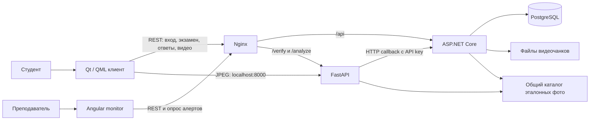

# ExamGuardian: анализ реализации относительно целей системы

Дата: 14 октября 2026 года. Основа: текущая рабочая копия поверх commit `6ee2c3a48b45ddfdf3fd9be12cba5a9d41cfdb96`, включая изменения, существовавшие до анализа.

## 1. Основной вывод

ExamGuardian содержит работающую основу распределённой системы прокторинга: нативный клиент, сервер экзаменов, отдельный процесс компьютерного зрения, панель преподавателя и локальное хранение данных. Разделение компонентов соответствует разным задачам и профилям нагрузки. Смена стека сама по себе не решает обнаруженные проблемы.

Главная слабость — отсутствие единого, защищённого процесса экзамена. Проверка личности, начало сессии, контроль среды, отправка ответов, доставка медиа и решение преподавателя существуют как отдельные действия. Сервер не обеспечивает обязательную связь между ними. Поэтому демонстрационный сценарий может работать, но результат экзамена и полнота доказательств пока недостаточно защищены.

Первый приоритет следует из основной цели системы: обеспечить достоверность результата дистанционного экзамена. Это требует подтверждённого допуска, принадлежности сессии студенту, серверного расчёта результата, наблюдаемого состояния мониторинга и проверяемых доказательств. Усложнение архитектуры без этих гарантий не приближает систему к цели.

## 2. Источники и границы проверки

Изучены диплом, текст всех 16 слайдов презентации, README, описания архитектуры в `web-site`, исходники Core, Inference, Client, Angular monitor, схемы EF Core и локальные миграции, конфигурация Docker/Nginx, сборка и упаковка клиента, портал скачивания. В PDF дополнительно визуально просмотрена диаграмма вариантов использования на странице 35.

Диплом и презентация использованы как источники целей и заявленных требований. Их утверждения о готовности, точности и защите не приняты как доказательство реализации. Существующий roadmap в документации также является предложением, а не реализованной функциональностью.

Проверены сборки, компиляция тестов Angular, синтаксис Python, состояние запущенных контейнеров и несколько запросов чтения без авторизации. Изолированно проверена функция проверки JWT из текущего исходника AI. Чужие изменения сохранены. Прикладной код не исправлялся, контейнеры не пересоздавались, данные экзаменов не изменялись.

Не проведены полноценный экзамен с камерой/микрофоном, проверка Linux, испытания обхода ограничений ОС, измерения качества моделей на размеченном наборе и нагрузочное тестирование. Для этих пунктов отчёт различает факт из кода и гипотезу, требующую испытаний. Запущенные образы могут отличаться от текущей рабочей копии.

Исходные документы:

- Диплом: `C:/Users/andbriha/Desktop/proct/диплом/+126 Гребенник Андрій Дмитрович - Володимир Вікторович Вичужанін.pdf`, особенно страницы 8–10, 33–37, 47–55, 63–65.
- Презентация: `C:/Users/andbriha/Desktop/proct/диплом/Презентація_прокторинг (2).pptx`, особенно слайды 3–4, 8–15.

## 3. Цели, которыми следует ограничить дальнейшую работу

Главная цель: помочь образовательной организации провести дистанционный экзамен с обоснованным доверием к личности участника, условиям сдачи и результату, сохранив материалы для проверки подозрений.

| Цель | Проверяемый результат | Состояние реализации |
| --- | --- | --- |
| G1. Подтвердить личность и живое присутствие | Допуск связан с конкретным участником и попыткой, повторная подмена обнаруживается | Есть предварительная проверка, серверный допуск и непрерывное сравнение личности отсутствуют |
| G2. Ограничить запрещённые способы получения помощи | Политика экзамена определяет ограничения, результат технических проверок известен | Есть Windows-проверки и часть блокировок, покрытие и политика неполны |
| G3. Достоверно провести экзамен | Назначение, время, ответы, завершение и результат контролирует сервер | Базовые вопросы и расчёт балла есть, важные правила обходятся или отсутствуют |
| G4. Помочь преподавателю замечать подозрительные события | Актуальные участники, состояние связи, сигналы по нужному экзамену | Есть список и опрос алертов, состояние присутствия и живой поток отсутствуют |
| G5. Сохранить проверяемые доказательства | Сигнал связан с материалом, временем и решением проверяющего | Есть видеочанки и таймкоды, доставка/связь/решения не гарантированы |
| G6. Защитить данные и восстановиться после сбоев | Ограниченный доступ, понятный срок хранения, восстановление попытки | Есть JWT в Core, BCrypt и volumes, но доступ и восстановление имеют существенные пробелы |
| G7. Работать на заявленных платформах и в реальном развёртывании | Проверенные возможности Windows/Linux и настраиваемый сервер | Windows-клиент собирается, Linux-защита неполна, адреса клиента локальные |

Вытекающие из целей правила: отсутствие телеметрии не равно отсутствию нарушений; подозрение AI не равно доказанному нарушению; балл за знания не равен оценке добросовестности; технический сбой должен иметь отдельное состояние и путь восстановления.

Не следует автоматически расширять проект до полноценной LMS, добавлять облако, брокер сообщений, Kubernetes или новый фронтенд. Каждое такое решение требует конкретной потребности из таблицы выше.

## 4. Фактическая архитектура

Core фактически не маршрутизирует кадры к AI. Qt знает отдельные адреса Core и AI. Nginx уже умеет проксировать AI-маршруты, но клиент обращается к `127.0.0.1:8000`. В запущенном окружении AI опубликован на всех интерфейсах, тогда как текущий compose ограничивает его loopback. Это подтверждает расхождение конфигурации и работающего развёртывания.

Сервер представляет собой многослойное приложение с отдельным AI-сервисом. BusinessLogicLayer зависит от DataAccessLayer и его сущностей. Доменные правила живут главным образом в сервисах, сущности являются контейнерами данных. Название Clean Architecture в README описывает реализацию неточно. Само по себе это не причина переписывать сервер. Важнее закрепить правила попытки и границы доверия.

Сильные решения, которые стоит сохранить:

- Изоляция Python/ML от API экзамена.
- Разделение QML и большей части C++-логики через ViewModel и signals/slots.
- Раздельные DTO, которые не выдают студенту `CorrectIndex` в ответе с вопросами.
- BCrypt для паролей и серверный расчёт результата по вопросам.
- Передача видео частями и поддержка range requests для просмотра.
- Разделение панели на подготовку, пользователей, мониторинг и архив.
- Постоянные Docker volumes для БД, фото и кеша моделей.

## 5. Критические нарушения доверия

Приоритеты: P0 — непосредственно нарушает доверие к личности, результату или данным; P1 — основной сценарий или доказательства ненадёжны; P2 — сопровождение, эксплуатация и удобство. Приоритет оценивает влияние на цели, а не сложность исправления.

### F01. P0: AI принимает неподписанный доверенным ключом JWT

В [verify_session.py](C:/Users/andbriha/Desktop/diploma/ExamGuardian/Inference/api/routes/verify_session.py:40) отключена проверка срока, issuer и audience. После неудачной проверки кандидатными ключами функция декодирует токен с `verify_signature=False`. Изолированный запуск этой функции из текущего исходника подтвердил приём токена с посторонним ключом и истёкшим сроком. Результат проверки относится к функции, а не к полному биометрическому сценарию.

Следствие для G1/G6: идентификатор пользователя, по которому выбирается эталонное фото, перестаёт быть достоверным. Требуется обязательная проверка подписи и срока, единый контракт claims и отказ при любой ошибке. Известные резервные ключи и permissive fallback не должны входить в рабочий путь.

### F02. P0: студент может передать итоговый балл и чужую сессию

[ExamSessionsController](C:/Users/andbriha/Desktop/diploma/ExamGuardian/Core/Core/Controllers/ExamSessionsController.cs:93) принимает `score` из query и передаёт его в FinishSessionAsync. Проверка роли Student есть, проверки владельца сессии и диапазона балла нет. В Start StudentId берётся из токена только при пустом GUID, поэтому непустое значение клиента принимается.

[ExamsController](C:/Users/andbriha/Desktop/diploma/ExamGuardian/Core/Core/Controllers/ExamsController.cs:117) рассчитывает балл для examId из URL, затем завершает SessionId из тела без проверки, что эта сессия принадлежит текущему студенту и тому же экзамену. В результате корректно рассчитанный балл одного экзамена может быть записан в другую сессию. Эти пути установлены по коду, запросы изменения данных не выполнялись.

Следствие для G3: основной результат системы изменяется обходным путём. Балл должен вычисляться только сервером по принятой отправке ответов. Идентификатор студента должен происходить из проверенного principal. Каждая операция должна проверять владельца, соответствие экзамена, состояние и время попытки.

### F03. P0: доказательства доступны и изменяются без авторизации

[ViolationsController](C:/Users/andbriha/Desktop/diploma/ExamGuardian/Core/Core/Controllers/ViolationsController.cs:44) разрешает анонимную отправку клиентских нарушений, чтение и отметку reviewed. AI endpoint с API key существует, но не защищает альтернативный `/report`. [ExamSessionsController](C:/Users/andbriha/Desktop/diploma/ExamGuardian/Core/Core/Controllers/ExamSessionsController.cs:22) разрешает анонимное чтение сессий. Фото и видео также имеют AllowAnonymous.

На работающем API запросы без токена к `/api/ExamSessions`, `/api/Violations/unreviewed`, `/api/video/1/chunks` вернули 200. Для сравнения `/api/Students` и `/api/Exams` вернули 401. Содержимое личных данных не выводилось в отчёт. Анонимные операции записи обнаружены статически и не исполнялись.

Следствие для G5/G6: посторонний может читать материалы и по коду создавать/скрывать сигналы. Требуются авторизация ресурсов и отдельное право преподавателя на проверку события. Ключ AI подтверждает отправителя AI, но самостоятельно не удостоверяет исходного студента.

### F04. P0: загрузка видео доверяет произвольному пути и разрешает перезапись

[VideoUploadController](C:/Users/andbriha/Desktop/diploma/ExamGuardian/Core/Core/Controllers/VideoUploadController.cs:36) соединяет storagePath со строковым sessionId без проверки формата и принадлежности. По контракту upload это произвольная строка. Такой ввод не гарантирует, что итоговый путь останется внутри каталога видео. Существующий чанк перезаписывается как retry без проверки совпадения содержимого. Студенческая роль не ограничивает загрузку собственной сессией.

Это риск целостности доказательств и произвольной записи файлов в доступной контейнеру области. Эксплуатация не выполнялась. Критерий исправления: сервер получает и проверяет числовой ID существующей попытки, строит путь самостоятельно, ограничивает размер/формат, принимает повтор одного и того же чанка идемпотентно и отклоняет иной контент с тем же номером.

## 6. Экзамен и допуск

### F05. P1: успешная проверка личности не является серверным условием старта

[ExamSessionService](C:/Users/andbriha/Desktop/diploma/ExamGuardian/Core/BusinessLogicLayer/Services/ExamSessionService.cs:44) проверяет наличие пользователя, экзамена и активной сессии. Никакого сохранённого результата проверки личности или среды не требует. Проверка среды и переход после биометрии организованы в QML. Сервер не знает, выполнены ли они.

Требуется серверный результат допуска с участником, попыткой, сроком, методом и версией проверки. Клиентский отчёт о среде полезен, но не превращает контролируемую студентом машину в полностью доверенную. Угроза изменения клиента должна быть явно описана.

### F06. P1: экзамен выбирается первым элементом списка

[ExamViewModel](C:/Users/andbriha/Desktop/diploma/ExamGuardian/Client/src/viewmodels/exam_viewmodel.cpp:90) берёт первый экзамен. `GetAvailableAsync` отдаёт все экзамены. Нет назначения группе/участнику, политики числа попыток и проверки расписания. Панель предлагает скопировать ID и ввести его в Qt, но такого выбора в текущем пути клиента нет.

Следствие для G3: студент может получить другой экзамен, а опубликованное время не является ограничением. Следует определить назначение экзамена и возвращать только разрешённые попытки/экзамены.

### F07. P1: сервер не контролирует время и допустимые переходы

У ExamSession только IsFinished и временные поля. Начать можно без проверки ScheduledStartTime, завершить без проверки DurationMinutes. Клиент считает время локальным таймером. При возврате активной сессии клиент начинает полный отсчёт заново. Гонки двух Start не закрыты уникальным ограничением активной попытки. Поиск active перед вставкой не является защитой от параллельной вставки.

Нужны отдельные состояния подготовки, допуска, сдачи, завершения, технического разрыва и принудительного прекращения, если оно входит в выбранный сценарий. Дедлайн должен определяться сервером. Возобновление должно возвращать оставшееся время и не переписывать историю.

### F08. P1: ответы и основания выставленного балла не сохраняются

Submit рассчитывает балл по переданному Dictionary, а в модели хранится только итоговый Score. Нет сохранённой отправки, ответов, версии экзамена и истории автосохранения. Изменения определения вопросов и повторные запросы не имеют полноценного контракта.

Для G3/G5 важно сохранить ответы и определение экзамена, по которому они оценивались, идентификатор отправки и серверное время приёма. Полноценный редактор курсов для этого не нужен.

### F09. P1: демонстрационные fallback маскируют ошибки

[ExamViewModel](C:/Users/andbriha/Desktop/diploma/ExamGuardian/Client/src/viewmodels/exam_viewmodel.cpp:31) подставляет локальные вопросы при ошибке загрузки, пустом списке или отсутствии токена. При ошибке Start всё равно вызывается examLoaded. По умолчанию ряд идентификаторов сессии равен 1. Без токена submit сообщает «сохранено локально», хотя записи ответов на диск в этом пути нет.

В рабочем экзамене ошибка должна оставлять состояние ошибки/восстановления. Деморежим должен включаться отдельно и явно. Сессия без подтверждённого server ID не должна отправлять события или видео.

## 7. AI: что он действительно устанавливает

### F10. P1: непрерывная идентификация отсутствует

[frame.py](C:/Users/andbriha/Desktop/diploma/ExamGuardian/Inference/api/routes/frame.py:24) вызывает анализ положения лица и YOLO. IdentityAnalyzer в непрерывном пути не вызывается. Поэтому после предварительной проверки другое лицо может удовлетворять проверке наличия лица. Контроль присутствия не подтверждает, что перед камерой остаётся тот же человек.

Для G1 нужна повторная проверка личности по обоснованному расписанию/триггеру и явное состояние неопределённости при плохом кадре. Частоту следует выбирать после измерения качества и нагрузки.

### F11. P1: liveness проверяет позу одного кадра

[LivenessAnalyzer](C:/Users/andbriha/Desktop/diploma/ExamGuardian/Inference/models/liveness_analyzer.py:60) проверяет координаты лица в одном изображении. Он не проверяет последовательность движения, свежесть кадров и соответствие выданному challenge. `presence_check` сразу проходит при наличии landmarks и принимается через query `task`, хотя в выдаваемом challenge его нет. Случайное задание не сохраняется на сервере и не привязано к попытке. Кеш подтверждения личности общий по login/id на 60 секунд и живёт в памяти одного процесса.

Это не доказывает заявленную устойчивость к фото/воспроизведению видео. Нужны привязанный challenge, срок и защита от повторного использования, проверка последовательности ответа и экспериментальное сравнение атак/обычных пользователей. Выбор специализированной модели оправдан только результатами такого сравнения.

### F12. P1: пороги и эвристики выдают чрезмерно уверенные сигналы

В дипломе/слайдах для identity указан 0.40, класс использует 0.65, маршрут дополнительно допускает distance < 0.68. `enforce_detection=False` ослабляет отказ при отсутствии корректного лица. Нельзя выбирать лучший порог по удобству прохождения без измерения ошибок допуска и отказа.

Yaw/pitch в коде являются нормализованными отношениями 2D landmarks, а не вычисленными углами Эйлера. Направление глаз отдельно не измеряется. [Проверка «micro_earpiece»](C:/Users/andbriha/Desktop/diploma/ExamGuardian/Inference/models/liveness_analyzer.py:219) основана на долях белых/тёмных пикселей в кропе около лица. Волосы, фон, тени и освещение могут влиять на такой результат. Указанный confidence вычисляется формулой, его калибровка не показана.

Для G4/G5 эти результаты должны оставаться подозрениями с контекстом. До проверенного датасета «микронаушник» не следует считать надёжным детектором. Нужны нейтральные названия событий, агрегирование во времени, политика допустимых предметов, проверка ложных срабатываний. VAD определяет речевую активность, но не личность говорящего и не содержание подсказки.

### F13. P1: аудиоанализ и запись экрана не подключены в клиенте

В AI есть `/analyze/audio` и WebRTC VAD. В Qt нет отправки PCM в этот маршрут. Микрофон участвует в записи видео через AudioInput, что не является входом VAD. В клиентском пути нет ScreenCapture/QScreenCapture. CaptureSession записывает камеру и микрофон.

Таким образом, заявленные аудиоалерты и видеодоказательства экрана не обеспечены сквозным сценарием. Следует отдельно решить, нужны ли оба канала для целевых угроз. Если нужны, провести их от захвата до проверки/хранения и отразить сбор в пользовательских правилах.

### F14. P1: анализ кадров/аудио не проверяет отправителя и сессию

У `/analyze/frame` и `/analyze/audio` нет зависимости авторизации. SessionId принимается из query, отсутствующий/нулевой подменяется 1. Студенческий ID не используется для проверки принадлежности. Поэтому AI может превратить недостоверный клиентский запрос в callback с доверенным API key.

Допустимы два будущих решения: вход через Core либо короткоживущий подписанный допуск к конкретной сессии для прямого канала в AI. Второй сохраняет изоляцию медианагрузки, но требует такого же строгого контракта. Сам факт прямого канала не ошибка, ошибка — отсутствие проверенной связи с попыткой.

## 8. Доказательства, время и восстановление

### F15. P1: финальная доставка медиа не гарантирована

[CoreApiClient](C:/Users/andbriha/Desktop/diploma/ExamGuardian/Client/src/network/core_api_client.cpp) делает одну попытку upload и удаляет локальный файл при HTTP-успехе. При отказе файл остаётся, но устойчивой очереди и повторной отправки нет. Ошибка videoUploadFailed не передаётся в пользовательский путь MediaViewModel.

[Main.qml](C:/Users/andbriha/Desktop/diploma/ExamGuardian/Client/qml/Main.qml:48) завершает приложение после любого успешного upload, когда isExamActive уже false. Если предыдущий чанк завершит загрузку раньше финального, возможен выход при незавершённой финальной передаче. При её отказе возможна обратная ситуация: ожидание без понятного результата. Это вывод из порядка асинхронных событий, а не проведённый аварийный тест.

Нужна очередь на диске с manifest, подтверждением конкретных чанков, идемпотентными retries и восстановлением после запуска. Завершение ответов и завершение доказательств должны иметь отдельные состояния. Длительный сбой медиа не должен заставлять студента бесконечно оставаться в заблокированном интерфейсе.

### F16. P1: перечисление чанков ломается при пропуске номера

[GetChunks](C:/Users/andbriha/Desktop/diploma/ExamGuardian/Core/Core/Controllers/VideoUploadController.cs:72) присваивает chunkIndex по позиции файла в отсортированном списке, вместо извлечения номера из имени. Например, `chunk_001.mp4` и `chunk_003.mp4` возвращаются как чанки 1 и 2, URL второго указывает на отсутствующий `chunk_002.mp4`. При четырёхзначных номерах строковая сортировка также не гарантирует числовой порядок.

Номер и временной диапазон должны происходить из проверенных метаданных, пропуски нужно сохранять явно.

### F17. P1: нет единого времени доказательств

Запись и непрерывный анализ начинаются в `enterExamMode`, затем ExamScreen загружает экзамен и запускает серверную сессию. MediaValidator отсчитывает от своего старта, отчёты о процессах — от момента ответа Start, сервер — от StartTime. При возобновлении счётчики клиента и индексы чанков начинаются снова. Начальные кадры могут отправляться до получения корректного sessionId.

Панель предполагает точные 60 секунд на чанк и ищет `floor(timestamp / 60) + 1`. Реальные задержки stop/record, длительность финального чанка и потери создают расхождения. Таймкоды после смены чанка устанавливаются по таймауту 300/500 мс, а не по событию готовности конкретного файла.

Для G5 требуется общий временной контракт: время захвата, монотонное смещение, последовательность, фактическое начало/длительность материала и связь с попыткой. Панель должна искать доказательство по диапазону записи, а не по предположению о минуте.

### F18. P1: событие может потеряться или остаться без доказательства

[notifier.py](C:/Users/andbriha/Desktop/diploma/ExamGuardian/Inference/core/notifier.py:23) отправляет callback один раз. Ошибка только логируется, BackgroundTasks не является устойчивой очередью. В кадровом пути не сохраняются стоп-кадры и не передаётся evidence_url. Видео может дать контекст, только если оно успешно доставлено и корректно связано по времени.

Каждому событию нужен ID для повторной доставки, состояние подтверждения и связь с материалом. Механизм надёжной доставки можно выбрать после определения допустимых потерь и нагрузки. Для начала не обязательно вводить отдельный брокер.

## 9. Панель преподавателя и решения

### F19. P1: мониторинг показывает неполное и иногда вымышленное состояние

[MonitorComponent](C:/Users/andbriha/Desktop/diploma/ExamGuardian/monitor/src/app/pages/live/monitor/monitor.ts:78) опрашивает непроверенные алерты раз в 8 секунд. Список участников и видео загружаются при первоначальной загрузке/выборе, периодический цикл обновляет только alerts. Heartbeat, lastSeen и причина потери связи отсутствуют.

`fallbackLoadStudents` создаёт sessionId = idx + 1, статус «Складання», а первому студенту присваивает три нарушения. Это может связать реальный профиль с чужой сессией и чужим видео. `refreshAlerts` получает глобальные непроверенные события, не фильтруя экзамен. По клику на событие неизвестной сессии возможен seek в видео текущего студента. Список «активных» экзаменов включает все экзамены; архив включает и незавершённые сессии; список экзаменов назначает всем статус active.

Для G4 интерфейс должен показывать реальные состояния, отдельно loading/error/empty, фильтровать события по экзамену и запрещать переход к материалу другой сессии без её загрузки. Обновление через SSE/WebSocket можно выбрать по требованию задержки, но сначала нужно исправить достоверность данных. Текущий проигрыватель является просмотром записанных чанков, а не живым видеопотоком.

### F20. P1: подтверждение и отклонение сохраняют одно значение

[ViolationDetailComponent](C:/Users/andbriha/Desktop/diploma/ExamGuardian/monitor/src/app/pages/archive/violation-detail/violation-detail.ts:290) вызывает один markAsReviewed и для confirm, и для reject. Модель хранит только IsReviewed. Автор, основание и вердикт отсутствуют. Более того, обработчики ошибок показывают успешное подтверждение/отклонение. SendWarning показывает alert, но ничего не отправляет студенту.

Отдельное действие toggleStatus в базе студентов тоже меняет только локальный объект. Принудительное прекращение попытки сервером не реализовано. Наличие кнопок/типов в UI не доказывает соответствующую возможность.

Для G5 нужны Pending/Confirmed/Dismissed, проверяющий, время и причина. Ошибка сохранения должна оставлять решение неподтверждённым. Нереализованные действия следует скрыть либо довести до сервера и клиента в выбранном объёме.

### F21. P1: отчёт смешивает технический результат и решение о доверии

[ReportsHubComponent](C:/Users/andbriha/Desktop/diploma/ExamGuardian/monitor/src/app/pages/archive/reports-hub/reports-hub.ts:99) определяет passed по локальному порогу 60, а причину короткой сессии угадывает по duration < 20 и score = 0. Ноль нарушений отображается как подтверждение успешной проверки, хотя мониторинг мог отсутствовать. «PDF» — печатная HTML-страница, созданная браузером, без серверного снимка заключения.

Результат теста, техническая полнота мониторинга и решение о добросовестности должны быть отдельными полями. Если нужен проходной балл, его задаёт политика экзамена. Вывод не должен угадывать причину сбоя. Данные title/studentName подставляются в `document.write` без экранирования, что создаёт отдельный риск HTML-инъекции в печатном окне.

В клиенте процентный score выводится «из числа вопросов»: например, 100 из 3. Даже успешный расчёт получает неверную интерпретацию. Этот дефект следует исправлять вместе с единым контрактом результата.

## 10. Ограничения ОС и кроссплатформность

Windows hook в [InputBlocker](C:/Users/andbriha/Desktop/diploma/ExamGuardian/Client/src/system/input_blocker.cpp:13) блокирует Win и Alt+Tab. Перечисленные в README Ctrl+Esc, Ctrl+Shift+Esc, Alt+F4 и PrintScreen там не обрабатываются. Ошибка установки hook только логируется и не препятствует старту. Получение активного заголовка окна есть, но непрерывной политики контроля фокуса в пути экзамена не найдено.

Сканер обнаруживает имена и PE version metadata. SHA-256 вычисляется для снимка и локального JSON-протокола, но не сверяется с доверенным списком программ. PE metadata не является криптографической подписью издателя. Протокол остаётся локальным и не привязан к серверным доказательствам. Во время экзамена каждые 5 секунд проверяются подозрительные процессы, но полная проверка мониторов/камер/среды не повторяется.

Детектор виртуальной машины использует CPUID, BIOS/реестр, драйверы, MAC и диски. Порог 45 при весе CPUID 55 означает, что одного признака гипервизора достаточно для блокировки. Требуется проверить ложные отказы на разрешённых конфигурациях, включая Windows с функциями виртуализации. Проверка названия камеры через Qt не является заявленной глубокой проверкой DirectShow/аппаратного происхождения потока. Покрытие внешних KVM/карт захвата кодом не доказано.

Linux ветви блокировки используют keyboard grab и gsettings, но сканирование процессов и основные проверки виртуализации реализованы под Windows. Поэтому одинаковая степень защиты платформ не обеспечена. Linux gsettings reset возвращает значения по умолчанию, а не прежние пользовательские настройки. Аварийное восстановление отдельно не организовано. Скрипт build.sh ожидает `Release/ProctoringClient`, тогда как CMake создаёт appClient.

Для G2/G7 следует определить матрицу поддерживаемых возможностей. Минимально обоснованный вариант — честный Windows-пилот и отдельный этап Linux. Если две платформы обязательны сразу, их реализация и испытания становятся частью готовности. Любое ограничение ОС должно возвращать результат установки и иметь безопасное освобождение/восстановление. Заявление об абсолютном предотвращении всех обходов из текущего кода не следует.

## 11. Данные, инфраструктура и сопровождение

**Схема БД невоспроизводима из Git.** Локальные миграции существуют, но [Core/.gitignore](C:/Users/andbriha/Desktop/diploma/ExamGuardian/Core/.gitignore:12) исключает Migrations/. `git ls-files` не возвращает файлы миграций. DbInitializer вызывает Database.Migrate, поэтому локальный успешный запуск не доказывает инициализацию чистого клона. Это P1 для G6. Требуется версионированная схема и проверка развёртывания на пустой БД.

**Модель БД не закрепляет важные инварианты.** Уникальность Login проверяется запросом перед вставкой без уникального индекса. Нет ограничения активной попытки, диапазонов балла/confidence/времени и политики сохранения ответов. GetByStudent/GetByExam не загружают те же связи, что GetAll: маппинг имени/числа нарушений может давать пустые значения. Чтение больших списков и всех нарушений без пагинации увеличивает нагрузку.

**Удаление и хранение требуют определённого поведения.** Связь User → Sessions каскадная, удаление студента может удалить связанные записи попыток/событий. Фото и файлы видео при этом не удаляются тем же процессом. Retention, резервное копирование/восстановление, журнал доступа и решение о жизненном цикле доказательств не реализованы. Это техническая оценка, не юридическое заключение о соответствии GDPR.

**Общие секреты и демонстрационный доступ.** В tracked-конфигурации есть известные значения ключей и пароль БД, автоматический seed создаёт преподавателя с фиксированным паролем, панель показывает эти учётные данные. Для локальной демонстрации это удобно, для размещения в организации нужен явный bootstrap и секреты окружения. CORS без списка origins разрешает произвольный origin с credentials. Политика должна соответствовать реальным клиентам.

**Транспорт и адреса.** Текущий Nginx слушает HTTP, Qt использует жёстко заданные localhost/127.0.0.1. Студент на другом компьютере не получает университетский сервер из конфигурации. UseHttpsRedirection в Core не добавляет сертификат и защищённый транспорт на Nginx. Refresh cookie Secure, а панель не вызывает refresh, Qt не запускает автоматическое обновление токена. Следует определить единый origin, конфигурацию клиента, TLS и поведение при истечении доступа.

**Готовность контейнеров.** Healthcheck есть у PostgreSQL, у Core/AI — нет. depends_on AI от API означает порядок запуска, но не готовность API/прогретых моделей. Во время проверки работали db/api/ai, nginx в выводе compose ps отсутствовал. Работающая публикация порта AI отличается от текущего compose. Нужны readiness с проверкой необходимых моделей и безопасная проверка фактической версии конфигурации.

**Нагрузка AI не определена.** `run_in_threadpool` разгружает event loop, но сам по себе не гарантирует throughput и 100 мс. Face и YOLO в frame.py ожидаются последовательно. Модели кешируются как общие экземпляры процесса и вызываются из threadpool без явной стратегии конкурентного доступа. Требуется проверить поддержку такой нагрузки и задать ограничение параллелизма/очереди. Qt отправляет кадры по таймеру без ограничения числа незавершённых запросов. При медленном сервере возможны накопление и устаревшие результаты.

**Стабильность сборки.** requirements.txt Python не закрепляет версии. Отсутствующие веса могут скачиваться при запуске. Docker tags частично плавающие. Qt installer script упаковывает уже существующий EXE, может взять debug или старый бинарник из Landing, и не выполняет сборку исходников. Портал содержит несколько бинарников без подтверждённой связи с конкретным commit. Для воспроизводимости нужны версии зависимостей/весов и проверяемый release из исходников.

**Структура кода.** UnitOfWork выбирает репозитории по типу и создаёт их через new/Activator, сервисы приводят generic interface к специализированным. UserService использует другой путь сохранения. Controller работает с файловым хранилищем, ViewModel самостоятельно делает часть REST-запросов, QML координирует запись и завершение. Результат — сложность обеспечить общие правила. Уместно отделить use cases сессии, доступ к хранилищу и координацию клиента. Универсальный рефакторинг всех слоёв до исправления инвариантов не нужен.

**Панель и UX.** Guards и автоматическая обработка 401/refresh отсутствуют, token в localStorage считается достаточным признаком входа без проверки expiry. Справочник групп жёстко задан при создании, но группы в базе являются строками. Сервер не проверяет содержательную корректность длительности/вариантов/правильного индекса/баллов. При удалении варианта перед правильным индексом редактор не всегда сохраняет прежний правильный ответ. Требуется валидация серверного контракта, а не только формы.

## 12. Документация и реализация расходятся

| Заявление | Проверенное состояние |
| --- | --- |
| Core оркестрирует медиапоток | Qt обращается в AI напрямую |
| Непрерывная биометрическая верификация | Предварительный identity, затем проверка присутствия/позы |
| Активная защита от фото и записанного видео | Анализ одной позы, challenge не закреплён |
| WebSocket/SignalR и живое видео | REST polling 8 секунд и проигрывание чанков |
| Полный state machine экзамена | IsFinished, время, балл |
| Guards и роли на страницах панели | В routes guards отсутствуют |
| Блокировка полного списка горячих клавиш | Windows hook обрабатывает Win/Alt+Tab |
| SHA-256 подтверждает допустимость программ | Хеширование локального снимка, без доверенного списка |
| DeepFace threshold 0.40 | Фактически 0.65 и дополнительный допуск < 0.68 |
| Кадр каждые 500 мс | Клиентский continuous timer 1000 мс |
| Только стоп-кадры нарушений | Запись камеры/микрофона минутными чанками, стоп-кадр в событии не сохраняется |
| Полноценный review и отправка предупреждений | Общий reviewed-флаг, локальные сообщения UI |
| Стек ASP.NET 8/9 и Angular 19 | csproj net10.0, Angular package.json 20.3 |

Документы требуют согласования с выбранной версией продукта. Результаты нескольких демонстрационных сценариев на слайде 14 не дают статистической оценки точности: нет выборки, протокола, распределения условий, ошибок допуска/отказа и воспроизводимого набора. Соответствие стандартам и нейтрализация всех четырёх угроз не установлены этим аудитом.

## 13. Выполненная техническая проверка

| Проверка | Результат и граница вывода |
| --- | --- |
| `dotnet build Core/Core.sln --no-restore --nologo` | Успех, 0 ошибок/предупреждений. Использует локально восстановленные зависимости |
| CMake build существующего Qt 6.10.1 MinGW Debug каталога | Успех. Это существующая Windows-конфигурация, не чистая сборка и не Linux |
| `npm ci --ignore-scripts --no-audit --no-fund` в monitor | Установлены зависимости по lockfile. Прикладные файлы не изменены |
| `npm run build` в monitor | Успех. Предупреждения о трёх CSS budgets и устаревшей baseline mapping |
| `tsc -p tsconfig.spec.json --noEmit` | Ошибка: 7 тестовых файлов импортируют несуществующие прежние имена компонентов |
| `npm run build` в web-site | Успех, 14 страниц |
| Python AST parse | 12 исходников Inference проходят синтаксическую проверку. Это не проверка качества инференса |
| `docker compose ps` | db/api/ai запущены; nginx в списке запущенных сервисов отсутствовал |
| Чтение работающего API без токена | 200 для сессий, непроверенных нарушений и списка чанков. 401 для списка студентов/экзаменов |
| Изолированный вызов текущего JWT verifier | Принят просроченный токен с посторонней подписью |
| Проверка Git миграций | Локальные файлы существуют, исключены Core/.gitignore, в tracked files отсутствуют |

Наличие успешных сборок подтверждает техническую жизнеспособность основы. Оно не подтверждает безопасность экзамена, полноту доказательств или качество AI. Backend/AI/Qt автоматические тесты предметных сценариев в проверенной tracked-структуре не найдены. Каталог .github/workflows пуст.

## 14. Направление архитектуры, выведенное из целей

Это предложение для обсуждения после анализа, а не уже начатое изменение.

Core остаётся единственным владельцем попытки, времени, доступа, результата и решения преподавателя. AI формирует наблюдения с типом, качеством входа, версией модели и временем захвата. Qt обеспечивает проверку среды/захват и устойчивую отправку, но не назначает балл и не подтверждает серверный допуск самостоятельно. Панель показывает сохранённые факты и отправляет проверяемые команды.

Минимальная предметная модель: ExamDefinition/Policy; назначение участника; ExamAttempt с явными состояниями и deadline; VerificationResult; сохранённые Answers/Submission; EvidenceChunk с временным диапазоном/контрольной суммой; Observation; ReviewDecision с автором и основанием. Имена условные. Новые сущности оправданы необходимостью восстановить факт допуска, сдачи и проверки, а не желанием добавить слои.

Полезная последовательность состояний: подготовка → ожидает допуска → сдача → ответы приняты → доказательства ожидаются/полны → ожидает проверки → итог. Технический разрыв и прекращение должны иметь отдельную причину. Определённые состояния могут объединяться, если выбранный сценарий не требует отдельного этапа, но их смысл нельзя терять в одном bool.

### Порядок работ по влиянию на цели

| Этап | Что должно стать достоверным | Критерий завершения |
| --- | --- | --- |
| A. Границы доверия | Пользователь, собственная сессия, результат и доступ к материалам | Чужие ID, неверные/просроченные JWT, анонимные чтения/изменения и клиентский score отклоняются |
| B. Целостный экзамен | Назначение, допуск, время, сохранённые ответы, завершение | Сервер не допускает обход проверок, повторный Start не создаёт дубль, reconnect не добавляет время |
| C. Доказательства и сбои | Доставка, временная привязка, полнота мониторинга | Потеря сети/перезапуск не теряют очередь, отсутствующие чанки видны, финализация не выходит до нужных подтверждений |
| D. Достоверная панель и review | Настоящие статусы и сохранённое решение | Нет вымышленных сессий, события ограничены экзаменом, confirm/reject различаются, ошибки видны |
| E. Проверенное обнаружение | Качество сигналов для выбранных угроз | Размеченный набор, измеренные ложные допуски/отказы, привязанный challenge, подтверждённый сквозной audio/screen при необходимости |
| F. Реальное развёртывание | Новая машина и согласованные платформы | Чистый clone + пустая БД запускаются, клиент использует заданный сервер/TLS, readiness/backup/retention проверены |

Очередь C/E может уточняться по выбранному пилоту, но A/B обязательны раньше доверенного экзамена. Результат каждого этапа — завершённый вертикальный сценарий, а не массовая перестановка каталогов.

### Испытания, необходимые перед доверенным пилотом

- Студент не читает/завершает/дополняет чужую попытку; преподаватель действует только в разрешённой области.
- Нельзя начать без допуска, раньше расписания, сверх лимита попыток; нельзя сдать другой экзамен в SessionId текущего.
- Два параллельных Start дают одну попытку; повтор Submit не меняет принятую отправку и возвращает согласованный результат.
- Перезапуск клиента восстанавливает ответы, deadline, sequence и очередь видео.
- Разрыв сети во время записи, загрузки и последнего чанка отображается и восстанавливается без неверного сообщения об успехе.
- Пропуск чанка 2, задержанная доставка чанка 3 и неполная последняя минута не ломают просмотр/таймкоды.
- AI недоступен, модель не прогрелась, кадр повреждён, камера исчезла: система сообщает о потере наблюдения и не выводит «всё чисто».
- Подтверждение/отклонение/ошибка сохранения дают разные, проверяемые результаты; отсутствие алертов при отсутствии мониторинга не подтверждает добросовестность.
- Модели проверены на нормальном поведении, очках, тенях, разном положении камеры и выбранных атаках. Пороговые значения происходят из результатов испытаний.
- Пустая БД и чистый clone проходят запуск; backup действительно восстанавливает метаданные и материалы.

## 15. Решения о продукте, которые нельзя вывести только из кода

Перед проектированием реализации следует определить масштаб пилота и допустимую задержку, обязательность живого видео, Windows-only или равноправную Linux-поддержку, набор допустимых материалов/движений/речи, порядок апелляции и срок хранения. Нужно также решить, остаётся ли встроенный тест частью продукта или прокторинг должен сопровождать внешнюю экзаменационную систему. Диплом описывает несколько этих возможностей, но не задаёт проверяемую эксплуатационную политику.

Пока разумная рабочая граница — встроенный экзамен для ограниченного пилота с проверкой преподавателем, поскольку именно этот путь реально представлен в коде. Полную LMS-интеграцию, универсальную блокировку ОС и автоматическое заключение о нарушении нельзя считать обязательными без уточнения целей.

Практическая рекомендация после анализа: сохранить текущие компоненты и начать с этапа A, затем довести один сквозной сценарий из этапа B до устойчивого завершения с доказательствами. Это адресует слабость архитектуры через реальные гарантии системы.
