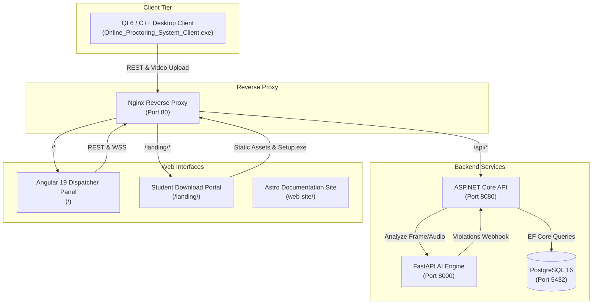

# Online Proctoring System (online-proctoring-system)

An enterprise-grade, privacy-first automated online proctoring system designed to ensure academic integrity in remote exams. The system combines low-level OS environment enforcement, high-performance media capture, real-time ML-powered behavior and audio analysis, and an organizer live-monitoring dashboard.

---

## 🌟 Key Capabilities & Anti-Cheat Mechanisms

### 1. Hardware & OS Level Enforcement (Qt C++ Client)
* **Low-Level Input Interception:** Windows Low-Level Keyboard Hooks (`WH_KEYBOARD_LL`) intercepting and suppressing system key combinations (`Alt+Tab`, `Win Key`, `Ctrl+Esc`, `Ctrl+Shift+Esc`, `Alt+F4`, `PrintScreen`).
* **Multi-Vector Virtual Machine & Sandbox Detection:**
  * **CPUID Hypervisor Check:** Queries CPUID function `0x1` (ECX bit 31) and retrieves hypervisor signature vendor strings (`0x40000000`).
  * **Registry & Hardware Artifacts:** Scans `HARDWARE\DESCRIPTION\System\BIOS` for VM signatures (`VMware`, `VirtualBox`, `QEMU`, `VBOX`, `Hyper-V`, `Xen`, `KVM`, `Parallels`).
  * **SCSI & Disk Drive ID Analysis:** Checks system disk model strings for virtual drive identifiers (`VBOX`, `VMware`, `QEMU HARDDISK`, `Virtual HD`).
  * **System Driver Scans:** Validates absence of known hypervisor driver binaries (`VBoxMouse.sys`, `vmmouse.sys`, etc.).
* **Process Scanning & Anti-Spoofing:**
  * Periodically scans all running processes via `CreateToolhelp32Snapshot`.
  * **Anti-Spoofing PE Verification:** Validates executable binary paths and extracts internal version metadata via `GetFileVersionInfoW` (`FileDescription`, `ProductName`, `CompanyName`, `OriginalFilename`) to detect renamed unauthorized applications (e.g. Discord, Telegram, OBS Studio, TeamViewer, AnyDesk).
  * Fast SHA-256 binary hash caching to prevent high CPU overhead.
* **Display & Video Device Auditing:**
  * Multiple display detection (forces single-monitor mode).
  * DirectShow virtual webcam filter inspection to block OBS Virtual Camera, ManyCam, and loopback feeds.

### 2. Intelligent Multimodal AI Analysis (FastAPI / PyTorch / ONNX)
* **Active Biometric Identity Verification:** Pre-exam face enrollment with DeepFace embedding matching against student profile references.
* **Continuous Head Pose & Gaze Tracking (MediaPipe Face Mesh):**
  * Real-time 3D facial landmark extraction calculating Euler angles ($\text{Yaw}, \text{Pitch}, \text{Roll}$).
  * **Lateral Hint Detection:** Flags looking left ($\text{yaw} < -0.19$) or looking right ($\text{yaw} > 0.19$) indicative of external notes or secondary monitors.
  * **Looking Down Detection:** Flags tilted gaze downwards ($\text{pitch} > 0.17$) indicating smartphone use on desk.
* **Prohibited Object Detection (YOLOv8):**
  * Real-time detection of smartphones, second persons, books, and suspicious handheld objects.
* **Micro-Earpiece / Foreign Object Detection:**
  * Ear canal region cropping based on facial keypoints and targeted detection of concealed wireless micro-earpieces (`micro_earpiece`).
* **Acoustic Activity Analysis (WebRTC VAD):**
  * Continuous voice activity detection detecting whispers, background coaching, or unauthorized vocalization.

### 3. Central Gateway & State Machine (ASP.NET Core 9 / PostgreSQL)
* Clean Architecture (Controllers, Services, Repositories, Entity Framework Core).
* Robust exam lifecycle state machine (`Scheduled`, `InProgress`, `Completed`, `TerminatedByProctor`, `Cancelled`).
* Protected credential management and group-based student batch enrollment.
* Video upload controller storing 60-second `.mp4` chunks with timestamped metadata for frame-accurate playback.

### 4. Real-Time Monitoring & Dispatching (Angular 19 SPA)
* Live dashboard with synchronized WebSockets/SignalR alert streams.
* Interactive multi-timeline video player with violation markers and instantaneous seek-to-second navigation.
* Instant printable PDF examination protocols with academic integrity scoring ($0-100\%$).

---

## 🏛️ System Architecture



---

## 🚀 Quick Start Guide

### Prerequisites
* **Docker & Docker Compose** (Linux, macOS, or Windows WSL2)
* **Qt 6.8+ / 6.10+ & MinGW 64-bit** (only if building the desktop client from source)
* **Inno Setup 6** (for building the student installer package)
* **Node.js 22+** (for Astro documentation website)

### 1. Launch Backend Services via Docker

Clone the repository and copy the environment configuration:
```bash
cp env.development.example .env
docker compose up -d --build
```

The services will become available at:
* **Organizer Monitor Dashboard:** `http://localhost/`
* **Student Landing & Installer Portal:** `http://localhost/landing/`
* **ASP.NET Core API Swagger:** `http://localhost:8080/swagger/index.html`
* **FastAPI AI Docs:** `http://localhost:8000/docs`

### 2. Build & Package Desktop Client (Windows)

To compile the native student application and build `Online_Proctoring_System_Setup.exe`:
```cmd
cd Client
build_installer.bat
```
The compiled installer will be automatically deployed into the `Landing/` folder for immediate student download.

### 3. Run the Documentation Website

The interactive documentation website is built with **Astro**, **Tailwind CSS**, and **MDX**:
```bash
cd web-site
npm install
npm run build
npm run preview
```

---

## 📖 Comprehensive Documentation
For in-depth architectural breakdowns, C4 model diagrams, API contracts, and deployment specifics, visit the interactive docs in `web-site/`:
* `01-system-context.mdx` — Business goals, threat model, compliance.
* `02-container-view.mdx` — High-level container architecture & protocols.
* `03-qt-client.mdx` — Qt/C++ internals: Windows hooks, anti-VM, anti-spoofing, chunking.
* `04-core-api.mdx` — ASP.NET Core Clean Architecture, REST endpoints & data models.
* `05-ai-engine.mdx` — YOLOv8, MediaPipe Face Mesh, Head-pose math, micro-earpiece analysis.
* `06-angular-monitor.mdx` — Angular 19 dispatcher panel, timeline player, protocol generation.
* `07-student-portal.mdx` — Static download portal & SmartScreen bypass instructions.
* `08-runtime-view.mdx` — End-to-end sequence diagrams for initialization, runtime & submission.
* `09-deployment-view.mdx` — Production container topology, volume persistence & reverse proxy.

---

## 📄 License
This project is developed for academic integrity research and university diploma defense. Released under the MIT License.