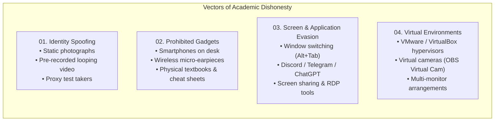

# 1. System Context & Security Threat Model

The **Online Proctoring System** is an enterprise-grade, privacy-first automated proctoring solution designed to protect academic integrity during remote examinations. It unifies low-level operating system controls, high-performance multimedia capture, continuous computer vision and audio machine learning pipelines, and a real-time dispatcher monitoring dashboard.

---

## 1.1 Purpose & Core Mission

Traditional online exams using commercial video conferencing platforms (Zoom, MS Teams, Google Meet) suffer from severe monitoring blind spots:
1. They cannot control the student's operating system or prevent running unauthorized software in the background.
2. They cannot detect virtual machines, secondary monitors, or hardware video capture devices.
3. Human proctors experience fatigue when monitoring multiple video tiles simultaneously, missing brief glances at concealed notes or whispers.
4. Commercial SaaS proctoring services charge high per-student fees and store sensitive student biometric data on foreign third-party cloud servers.

The **Online Proctoring System** solves these challenges through a self-hosted, scalable architecture that executes automated multi-modal analysis while keeping all institutional data on university-managed infrastructure.

---

## 1.2 The 4 Vectors of Academic Dishonesty

The system architecture is engineered specifically to counteract four primary vectors of remote exam cheating:

### Vector 1: Identity Spoofing & Impersonation
* **Attack:** A student replaces their live camera feed with a pre-recorded loop, holds up a high-resolution photo, or has another individual complete the exam.
* **Defense:** Pre-exam face enrollment with DeepFace facial embeddings, active liveness verification, and continuous MediaPipe facial mesh tracking ensuring the verified candidate remains in frame.

### Vector 2: Prohibited Gadgets & Hidden Assistance
* **Attack:** The candidate uses a smartphone positioned below the camera's normal field of view, wears a miniature wireless ear canal earpiece ("micro-earpiece"), or receives verbal prompts from an accomplice in the room.
* **Defense:** Continuous YOLOv8 object detection for mobile phones, ear canal bounding crop analysis for micro-earpieces, head-pose estimation detecting tilted gaze towards the desk (pitch > 0.17), and WebRTC Voice Activity Detection (VAD) flagging whispered conversations.

### Vector 3: OS Evasion & Unauthorized Software
* **Attack:** The candidate switches to browser windows or messenger applications (Discord, Telegram, WhatsApp), copies test questions into AI assistants (ChatGPT), or shares their screen via remote access tools (AnyDesk, TeamViewer).
* **Defense:** Native Windows Low-Level Keyboard Hooks (`WH_KEYBOARD_LL`) blocking system hotkeys (`Alt+Tab`, `Win`, `Ctrl+Shift+Esc`, `Alt+F4`, `PrintScreen`), combined with periodic process snapshot scanning and PE binary metadata inspection (`GetFileVersionInfoW`) to detect renamed executables.

### Vector 4: Virtual Machines & Hardware Camouflaging
* **Attack:** The candidate runs the proctoring client inside a virtual machine (VirtualBox, VMware, QEMU, Hyper-V) while searching for answers on the host OS, or feeds a synthetic video stream via a virtual webcam driver.
* **Defense:** Multi-vector hypervisor detection using CPUID hypervisor bit checks, registry BIOS manufacturer strings, SCSI virtual disk identifiers, system driver scans, and DirectShow virtual camera device audits.

---

## 1.3 System Actors & External Systems

The system interacts with several internal and external actors:

| Actor / System | Role | Primary Responsibilities |
| :--- | :--- | :--- |
| **Student (Candidate)** | End User | Downloads the native client, undergoes biometric and hardware verification, and completes the examination in a locked-down desktop environment. |
| **Exam Proctor / Examiner** | Administrative User | Creates exam sessions, configures time limits and passing criteria, monitors real-time student feeds, inspects AI alerts, and audits session playback. |
| **System Administrator** | Technical User | Manages Docker infrastructure, handles PostgreSQL database backups, configures Nginx SSL certificates, and reviews API service health. |
| **External LMS (Moodle / Canvas)** | External System | Optional upstream source for student rosters, exam questions (via IMS QTI standard), and grade synchronization. |

---

## 1.4 Regulatory Compliance & Privacy (GDPR)

The system adheres to strict data privacy principles:
* **Explicit Biometric Consent:** Before any hardware access is enabled, the student must review and explicitly accept the privacy policy and consent to webcam and audio recording.
* **On-Premise / Institutional Data Ownership:** All database records, biometric embeddings, and video recordings are stored exclusively within the institution's self-hosted deployment.
* **Ephemerality of Raw Feeds:** Video chunks are partitioned into 60-second segments, compressed via H.264, and subject to institutional retention policies, eliminating long-term unnecessary storage of biometric data.

---

## 1.5 C4 Context Diagram

The following C4 Context diagram illustrates the system boundary and the interactions between users, the proctoring platform, and external systems:

{`
graph TD
    %% Actors
    Student([Student / Candidate]):::actor
    Proctor([Examiner / Proctor]):::actor
    Admin([System Administrator]):::actor
    LMS[External LMS / SIS Moodle, Canvas, QTI]:::external

    %% System Boundary
    subgraph SystemBoundary["Online Proctoring System Boundary"]
        OPS[Online Proctoring System Core Platform]:::system
    end

    %% Interactions
    Student -->|Downloads client, performs biometric check, completes exam & streams video/telemetry| OPS
    Proctor -->|Creates exams, monitors live sessions, reviews AI violation alerts & exports protocols| OPS
    Admin -->|Deploys Docker containers, monitors health, manages database backups| OPS
    OPS -.->|Imports QTI test questions & exports grades/reports| LMS

    classDef actor fill:#0284c7,stroke:#0369a1,stroke-width:2px,color:#ffffff;
    classDef system fill:#0f172a,stroke:#38bdf8,stroke-width:3px,color:#ffffff;
    classDef external fill:#64748b,stroke:#475569,stroke-width:2px,color:#ffffff;
`}

