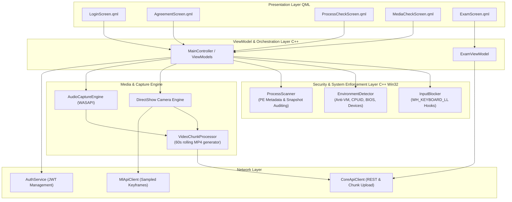
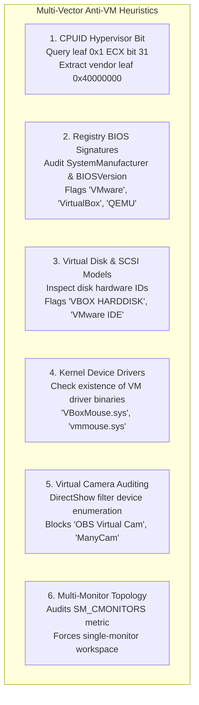
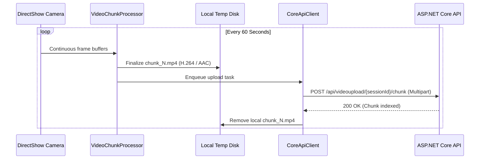

# 3. Component View: Qt Desktop Client

The **Desktop Client** (`Online_Proctoring_System_Client.exe`) is the frontline security component of the platform. Written in modern C++17 and powered by Qt 6, it enforces strict operating system lockdown, executes multi-layered anti-virtualization and anti-tamper heuristics, captures multimedia feeds, and renders the examination interface.

---

## 3.1 Architectural Decomposition

The application is structured using a strict Model-View-ViewModel (MVVM) and Service-Oriented pattern, isolating low-level Win32 system APIs from UI rendering and network I/O:



---

## 3.2 OS Lockdown: Low-Level Input Interception (`InputBlocker`)

To prevent students from switching tasks, accessing external web browsers, or cheating via keyboard shortcuts, the client registers a low-level Windows keyboard hook:

### Implementation Mechanism
* **Hook Registration:** Calls `SetWindowsHookExW(WH_KEYBOARD_LL, LowLevelKeyboardProc, hInstance, 0)`.
* **Key Suppression Logic:** The hook procedure intercepts virtual key codes before the Windows message loop processes them. Returning `1` from `LowLevelKeyboardProc` drops the key event entirely:

```cpp
LRESULT CALLBACK LowLevelKeyboardProc(int nCode, WPARAM wParam, LPARAM lParam) {
    if (nCode == HC_ACTION) {
        KBDLLHOOKSTRUCT *p = reinterpret_cast<KBDLLHOOKSTRUCT*>(lParam);
        
        bool isAlt = (p->flags & LLKHF_ALTDOWN);
        bool isCtrl = (GetAsyncKeyState(VK_CONTROL) & 0x8000);
        bool isShift = (GetAsyncKeyState(VK_SHIFT) & 0x8000);

        // Block Alt+Tab and Alt+Esc (Window switching)
        if (isAlt && (p->vkCode == VK_TAB || p->vkCode == VK_ESCAPE)) return 1;

        // Block Windows Keys (Start Menu)
        if (p->vkCode == VK_LWIN || p->vkCode == VK_RWIN) return 1;

        // Block Ctrl+Esc (Start Menu alternative)
        if (isCtrl && p->vkCode == VK_ESCAPE) return 1;

        // Block Ctrl+Shift+Esc (Task Manager shortcut)
        if (isCtrl && isShift && p->vkCode == VK_ESCAPE) return 1;

        // Block Alt+F4 (Force Close window)
        if (isAlt && p->vkCode == VK_F4) return 1;

        // Block PrintScreen / Win+Shift+S (Screen Capture)
        if (p->vkCode == VK_SNAPSHOT) return 1;
    }
    return CallNextHookEx(nullptr, nCode, wParam, lParam);
}
```

* **Full-Screen Kiosk Mode:** The main Qt window flags are set to `Qt::FramelessWindowHint | Qt::WindowStaysOnTopHint`, maximizing across the primary display viewport and preventing minimization.

---

## 3.3 Multi-Vector Anti-VM & Sandbox Detection (`EnvironmentDetector`)

Running the proctoring client inside a Virtual Machine allows candidates to cheat on the unmonitored host OS. To eliminate this vector, the client applies a 6-layer heuristic detection matrix:



### 1. CPUID Hypervisor Query
* CPUID function `0x1` returns CPU feature flags in `ECX`. Bit 31 is the standard hypervisor present flag:
```text
is_hypervisor = (ecx >> 31) & 1
```
* If set, calling CPUID function `0x40000000` returns the hypervisor vendor string in registers `EBX`, `ECX`, and `EDX` (e.g. `"VMwareVMware"`, `"VBoxVBoxVBox"`, `"Microsoft Hv"`, `"KVMKVMKVM"`, `"XenVMMXenVMM"`).

### 2. Registry BIOS & System Artifacts
* Reads `HKEY_LOCAL_MACHINE\HARDWARE\DESCRIPTION\System\BIOS`:
  * `SystemManufacturer`
  * `SystemProductName`
  * `BIOSVersion`
* Scans strings for known hypervisor signatures (`"VirtualBox"`, `"VMware"`, `"QEMU"`, `"Hyper-V"`, `"Parallels"`, `"InnoTek"`).

### 3. SCSI & Storage Device ID Inspection
* Traverses `SYSTEM\CurrentControlSet\Services\Disk\Enum` and system setup device nodes.
* Flags virtual hard disk identifiers: `"VBOX HARDDISK"`, `"VMware Virtual IDE"`, `"QEMU HARDDISK"`, `"Virtual HD"`.

### 4. Hypervisor Driver Files
* Verifies whether virtual machine guest additions are active by checking kernel driver paths:
  * `C:\Windows\System32\drivers\VBoxMouse.sys`
  * `C:\Windows\System32\drivers\VBoxGuest.sys`
  * `C:\Windows\System32\drivers\vmmouse.sys`
  * `C:\Windows\System32\drivers\vmhgfs.sys`

### 5. Virtual Camera Detection
* Enumerates installed DirectShow video capture filters using `ICreateDevEnum` and `CLSID_VideoInputDeviceCategory`.
* Prohibits virtual video loopback devices (`"OBS Virtual Camera"`, `"ManyCam Virtual Webcam"`, `"vMix Video"`, `"CamTwist"`).

### 6. Multi-Monitor Lockdown
* Calls `GetSystemMetrics(SM_CMONITORS)`.
* If more than one active display is detected, the exam start button is disabled until secondary monitors are physically unplugged or set to single-screen mode (`Win+P` $\rightarrow$ PC screen only).

---

## 3.4 Process Scanner & Anti-Spoofing PE Inspection (`ProcessScanner`)

Students frequently attempt to run Discord, Telegram, or remote desktop tools in the background, sometimes disguising them by renaming executables (e.g., renaming `discord.exe` to `svchost.exe`).

### Anti-Spoofing PE Verification
1. **Process Traversal:** Periodically captures a system process snapshot using `CreateToolhelp32Snapshot(TH32CS_SNAPPROCESS, 0)`.
2. **Process Path Resolution:** Obtains the full executable filesystem path using `OpenProcess` with `PROCESS_QUERY_LIMITED_INFORMATION` and `QueryFullProcessImageNameW`.
3. **PE Version Information Extraction:** Uses the Windows Version Management API (`GetFileVersionInfoSizeW`, `GetFileVersionInfoW`, and `VerQueryValueW`) to inspect binary metadata:
   * `OriginalFilename`
   * `FileDescription`
   * `ProductName`
   * `CompanyName`
4. **Signature Matching:** Compares both process name and internal PE strings against blacklisted prohibited software:

| Software Category | Target Applications | Action Triggered |
| :--- | :--- | :--- |
| **Communication / Messaging** | Discord, Telegram, Skype, WhatsApp, Slack, Zoom, MS Teams | Blocks Exam Start / Triggers Violation Event |
| **Remote Access / Screen Sharing** | TeamViewer, AnyDesk, UltraViewer, RustDesk, Parsec, VNC | Immediate Proctor Alert |
| **Streaming / Recording Tools** | OBS Studio, Streamlabs, Bandicam, Action!, Camtasia | Immediate Proctor Alert |
| **Browsers & DevTools** | Chrome (external), Firefox, Edge, Cheat Engine, Process Hacker | Forced Closure Warning |

5. **Performance Caching:** Hashes scanned executable paths and timestamps with SHA-256 to avoid repeated disk reads, maintaining under 1% CPU utilization.

---

## 3.5 Media Capture & Video Chunking Engine



* **Chunk Duration:** Fixed 60-second rolling cycles.
* **Format:** Encoded in standard `.mp4` (H.264 baseline profile for universal browser compatibility).
* **Fault-Tolerant Queue:** If an upload fails due to network degradation, chunks remain cached on the local drive in `%TEMP%\OnlineProctoringSystem\chunks\` and are re-attempted with exponential backoff before the final exam submission.