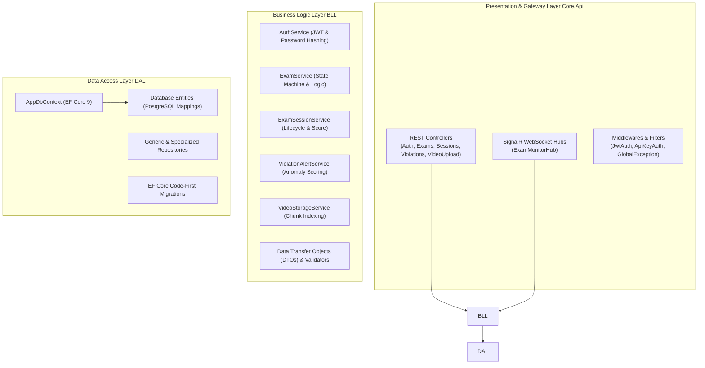
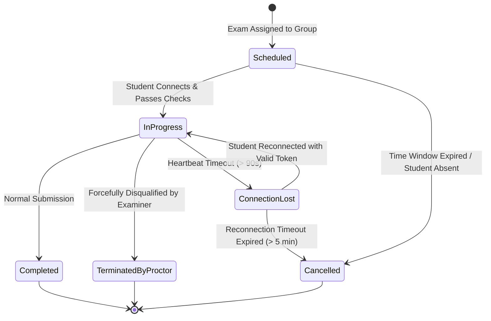
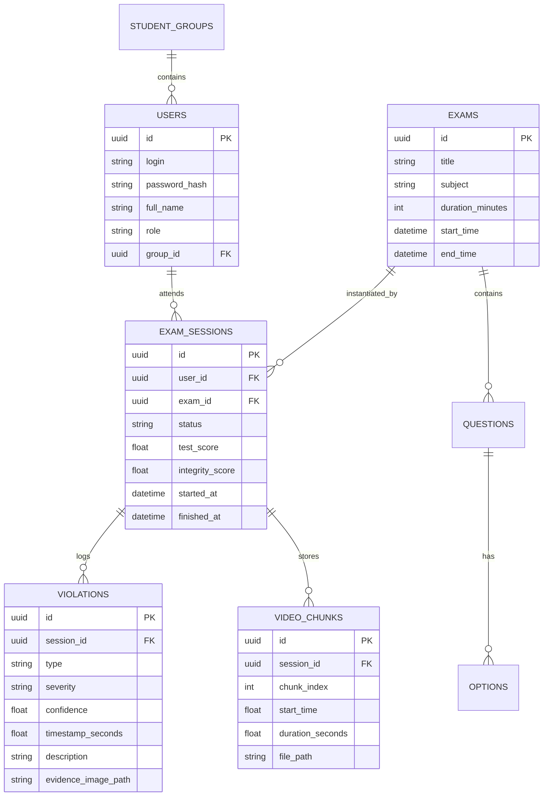

# 4. Component View: ASP.NET Core Gateway

The **Core API Gateway** is the central nervous system of the **Online Proctoring System**. Built with ASP.NET Core 9 and Entity Framework Core, it follows Clean Architecture and Domain-Driven Design (DDD) principles. It is responsible for authorization, state machine orchestration, video chunk indexing, AI webhook ingestion, and real-time SignalR WebSocket dispatching.

---

## 4.1 Layered Architecture

The solution adheres to clean separation of concerns across three distinct layers:



---

## 4.2 Key Endpoints & API Data Contracts

### 1. Authentication & Session Issuance
* **Endpoint:** `POST /api/auth/login`
* **Request:**
  ```json
  {
    "login": "student_kn21_04",
    "password": "SecurePassword123!"
  }
  ```
* **Response:**
  ```json
  {
    "token": "eyJhbGciOiJIUzI1NiIsInR5cCI6IkpXVCJ9...",
    "refreshToken": "d7a4f910-8b1e-4c3a-b852...",
    "userId": "3fa85f64-5717-4562-b3fc-2c963f66afa6",
    "role": "Student",
    "name": "Олександр Шевченко",
    "group": "КН-2021-1"
  }
  ```

### 2. AI Violation Ingestion Webhook
* **Endpoint:** `POST /api/violations/report`
* **Security:** Protected via internal service header: `X-AI-API-KEY: ${AiService__ApiKey}`
* **Payload:**
  ```json
  {
    "sessionId": "b81e4c3a-8b1e-4c3a-b852-2c963f66afa6",
    "violationType": "LookingLeft_NotesHint",
    "severity": "Warning",
    "confidence": 0.88,
    "timestampSeconds": 142.5,
    "evidenceImagePath": "/images/evidence_b81e_142.jpg",
    "description": "Head yaw angle -0.24 sustained for > 2.0s indicating glance at lateral cheat sheet"
  }
  ```
* **Processing:** Persists record to PostgreSQL `Violations` table, recomputes the student's integrity penalty, and broadcasts an alert to the Angular Monitor via SignalR.

### 3. Video Chunk Upload & Storage
* **Endpoint:** `POST /api/videoupload/{sessionId}/chunk`
* **Method:** `multipart/form-data`
  * `chunkIndex`: integer (e.g. `0`, `1`, `2`)
  * `startTime`: float (e.g. `0.0`, `60.0`, `120.0`)
  * `duration`: float (e.g. `60.0`)
  * `file`: binary video stream (`chunk_002.mp4`)
* **Storage Location:** Saved deterministically on disk at `/app/ExamVideos/{sessionId}/chunk_{chunkIndex:D4}.mp4`.
* **Metadata Endpoint:** `GET /api/videoupload/{sessionId}/chunks`
  * Returns an ordered manifest of available chunks for sequential browser video playback:
  ```json
  [
    { "index": 0, "startTime": 0.0, "duration": 60.0, "url": "/videos/b81e4c3a/chunk_0000.mp4" },
    { "index": 1, "startTime": 60.0, "duration": 60.0, "url": "/videos/b81e4c3a/chunk_0001.mp4" }
  ]
  ```

---

## 4.3 Examination Session State Machine

The examination session lifecycle follows a deterministic finite state machine to prevent race conditions or unauthorized retries:



### Integrity Scoring Engine
The final Academic Integrity Score is calculated automatically on a 0 - 100% scale:

```text
Integrity Score = max(0, 100 - SUM(weight_i))
```

Where violation weights are calibrated as follows:
* **Critical (weight = 25):** Unauthorized smartphone detected, secondary person in frame, micro-earpiece detected, virtual machine hypervisor detected.
* **Warning (weight = 8):** Sustained glance away from screen (|yaw| > 0.19 or pitch > 0.17), voice activity/whispering, prohibited background process closed late.
* **Info (weight = 2):** Brief single-frame face occlusion, low light level warning.

---

## 4.4 Entity Relationship Diagram (ERD)

