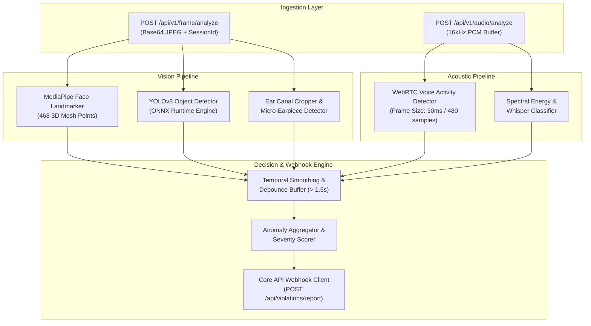

# 5. Component View: FastAPI AI Analytics Engine

The **AI Analytics Engine** is an isolated, horizontally scalable microservice built with Python 3.11, FastAPI, PyTorch, and ONNX Runtime. Operating asynchronously from the Core Gateway, it performs multi-modal computer vision and acoustic anomaly detection to identify cheating behaviors in real time.

---

## 5.1 Pipeline Overview



---

## 5.2 Mathematical Model: Head-Pose Estimation & Gaze Tracking

To detect when a student is looking away from their monitor toward cheat sheets or an accomplice, the system solves the **Perspective-n-Point (PnP)** problem in real time.

### 1. 3D Canonical Face Model
Six key facial landmarks are extracted from MediaPipe's 468 mesh points:
* Nose tip (Index 1)
* Chin (Index 199)
* Left eye outer corner (Index 33)
* Right eye outer corner (Index 263)
* Left mouth corner (Index 61)
* Right mouth corner (Index 291)

These 2D image coordinates `(u, v)` are mapped to a canonical 3D human head model `P_w = (X_w, Y_w, Z_w)^T` using OpenCV's `solvePnP` with Levenberg-Marquardt optimization:

```text
[ u, v, 1 ]^T = K * [ R | T ] * [ X_w, Y_w, Z_w, 1 ]^T
```

Where `K` is the camera intrinsic calibration matrix:
```text
K = [ [fx,  0, cx],
      [ 0, fy, cy],
      [ 0,  0,  1] ]
```

### 2. Euler Angle Decomposition
From the rotation matrix `R`, Euler angles (Yaw `ψ`, Pitch `θ`, Roll `φ`) are extracted:
```text
yaw   = atan2(R[1][0], R[0][0])
pitch = atan2(-R[2][0], sqrt(R[2][1]^2 + R[2][2]^2))
roll  = atan2(R[2][1], R[2][2])
```

### 3. Anomaly Decision Thresholds
* **Looking Left (Lateral Hint / Secondary Screen):**
  `yaw < -0.19 radians (~ -11°)`
* **Looking Right (Lateral Notes / Accomplice):**
  `yaw > +0.19 radians (~ +11°)`
* **Looking Down (Smartphone / Desk Cheat Sheet):**
  `pitch > +0.17 radians (~ +10°)`
* **Face Count Violations:**
  * Zero faces detected: Student absent or fully obscured.
  * More than 1 face detected: Unauthorized secondary person present in the testing room.

---

## 5.3 Prohibited Object Detection (YOLOv8)

The microservice runs an optimized YOLOv8 model packaged for **ONNX Runtime** with DirectML / CUDA acceleration:

| Class ID | Target Object | Confidence Cutoff | Severity Assigned |
| :--- | :--- | :--- | :--- |
| **67** | Cell Phone / Smartphone | >= 0.45 | **Critical** |
| **0** | Second Person | >= 0.50 | **Critical** |
| **73** | Book / Notes | >= 0.55 | **Warning** |
| **63** | Secondary Laptop | >= 0.50 | **Critical** |

### False Positive Mitigation
Single-frame transient spikes (e.g., student briefly scratching their ear or lifting a water bottle) are filtered by a **Temporal Sliding Window**:
* A violation is only triggered if an anomaly condition persists for at least 1.5 seconds across consecutive sampled frames.

---

## 5.4 Concealed Micro-Earpiece Detection

Students attempting high-stakes exam fraud sometimes use miniature magnetic or wireless inductive earpieces hidden inside the ear canal.


1. **Anatomical Anchor Localization:** The system tracks landmark 234 (left tragus) and landmark 454 (right tragus).
2. **Dynamic Ear Concha Cropping:** When the student's head rotates slightly (|yaw| >= 0.12), exposing the lateral ear canal, the ear region is cropped with a 1.4x margin.
3. **Contrast Normalization:** Applies Contrast Limited Adaptive Histogram Equalization (CLAHE) to reveal dark contours inside the auditory canal.
4. **Classification:** High-contrast foreign bodies matching the color and reflective signature of metallic micro-earpieces trigger an immediate proctor notification with a cropped visual snapshot.

---

## 5.5 Acoustic Anomaly Detection (WebRTC VAD)

Audio captured by the student's microphone is sent in 16kHz PCM chunks:
* **WebRTC Voice Activity Detection (VAD):** Evaluates 30ms windows (480 samples). Operating mode is set to aggressive (`mode = 3`) to eliminate steady ambient background fan or keyboard noise while sensitive to human speech formants.
* **Whisper Energy Ratio:** Calculates the ratio of high-frequency unvoiced energy (2 kHz - 4 kHz) to low-frequency voiced energy. High ratios in sustained audio chunks flag whispered answers or dictation.