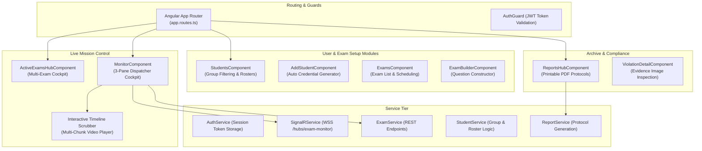
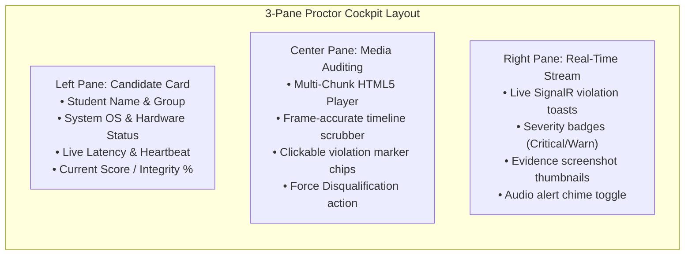

# 6. Component View: Angular Monitor & Dispatcher Panel

The **Monitor Panel** is an Angular 19 Single Page Application (SPA) designed for exam proctors, examiners, and academic administrators. It combines real-time WebSocket telemetry, interactive multi-chunk video auditing, automated student credential provisioning, and official academic integrity reporting.

---

## 6.1 Architectural Breakdown

The frontend leverages Angular's modern Standalone Component architecture, Signals for fine-grained reactivity, RxJS for asynchronous event streams, and Tailwind CSS for interface design:



---

## 6.2 The Dispatcher Cockpit (`MonitorComponent`)

The core monitoring view is organized into a high-density, three-pane layout optimized for split-second situational awareness:



### Dynamic Multi-Chunk Timeline Player
Because video is recorded and uploaded in discrete 60-second `.mp4` chunks to ensure fault tolerance, the web player implements a continuous virtual timeline:
1. **Manifest Ingestion:** Calls `GET /api/videoupload/{sessionId}/chunks` to retrieve all uploaded segments and compute total exam elapsed time:
```text
Total_Duration = SUM(chunk_duration_k)
```
2. **Global Scrubbing:** Dragging the scrubber to second `target_time` calculates the target chunk index `k` and local offset `t_local`:
```text
k = floor(target_time / 60.0)
t_local = target_time mod 60.0
```
3. **Seamless Chunk Switching:** Automatically swaps the HTML5 `<video>` element source to `chunk_k.mp4` and sets `currentTime = t_local`.
4. **Violation Overlay Markers:** Violations fetched from `GET /api/violations/session/{id}` are rendered as colored pins across the progress bar (Red for Critical, Yellow for Warning). Clicking any pin instantly seeks the video to that exact second.

---

## 6.3 Automated Credential Generation (`AddStudentComponent`)

To prevent manual errors and eliminate weak passwords, the student onboarding module provides instant cryptographic credential provisioning:
* **Structured Login Generation:** Automatically formats candidate logins using academic group codes:
```text
login = student_ + group_name + _ + uuid[0..4]
```
* **High-Entropy Passwords:** Uses `window.crypto.getRandomValues()` to construct 12-character alphanumeric passwords containing upper, lower, digits, and special characters.
* **One-Click Clipboard Export:** Examiners can immediately copy the credentials with formatted onboarding instructions to distribute to students.

---

## 6.4 Academic Integrity Protocol Generation (`ReportsHubComponent`)

At the conclusion of an exam, examiners can generate an official, tamper-evident examination protocol suitable for university accreditation and grade defense:
* **Automated Scoring Breakdown:** Compiles final test answers, passing thresholds, and net integrity deductions.
* **Chronological Anomaly Log:** Formats all flagged incidents with exact timestamps, AI confidence percentages, and proctor notes.
* **Print-Optimized Layout:** Standard CSS `@media print` rules strip out web navigation, ensuring clean pagination when printed to paper or saved as a PDF document.