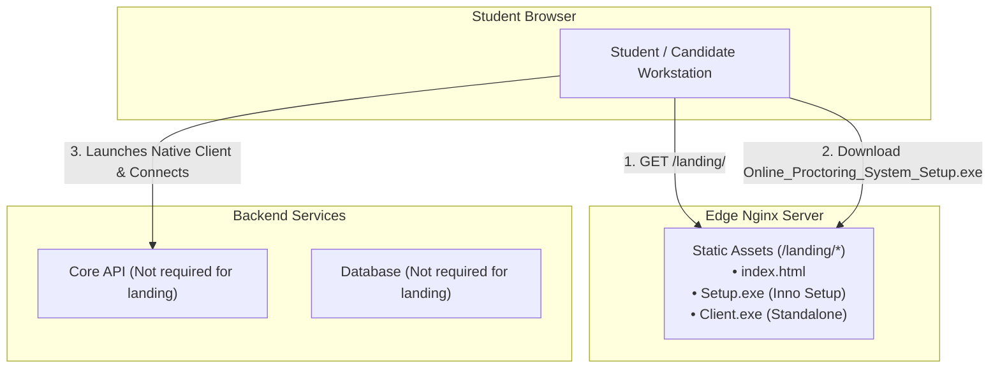
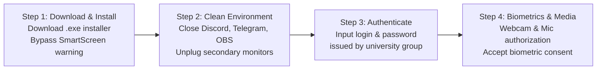

# 7. Component View: Student Portal & Distribution Architecture

The **Student Portal** is a static, zero-dependency onboarding and client delivery web application hosted under the `/landing/` route on the edge reverse proxy. It provides candidates with clear pre-exam guidelines, hardware requirements, troubleshooting walkthroughs, and direct download links for the Windows desktop client.

---

## 7.1 Design Principles & Architecture

To ensure 100% reliability even when backend databases or microservices are under peak examination load, the portal follows the **KISS (Keep It Simple, Stupid)** design principle:
* **Zero Server-Side Rendering (SSR) Dependencies:** Built using semantic HTML5, modern CSS3 with responsive flexbox/grid, and vanilla JavaScript.
* **Direct Edge Delivery:** Served directly from Nginx static file storage (`/usr/share/nginx/html/landing`), consuming negligible CPU and RAM on the host server.
* **Dual Distribution Channels:** Offers both an Inno Setup automated Windows installer (`Online_Proctoring_System_Setup.exe`) and a standalone portable executable (`Online_Proctoring_System_Client.exe`).



---

## 7.2 Onboarding Workflow for Candidates

The landing portal guides candidates through four sequential steps before their exam starts:



### 1. Windows SmartScreen Guidance
Because the client application is distributed within an academic institution and is not signed with an expensive commercial Extended Validation (EV) code signing certificate, Windows Defender SmartScreen may display an *"Unknown Publisher"* notification:
* The landing page provides explicit visual steps:
  1. Click **"More info"** (`Докладніше`).
  2. Click **"Run anyway"** (`Виконати у будь-якому разі`).

### 2. Minimum System Requirements Matrix

| Parameter | Minimum Requirement | Recommended Specification |
| :--- | :--- | :--- |
| **Operating System** | Windows 10 (64-bit, Version 1909+) | Windows 11 (64-bit) |
| **Processor (CPU)** | Intel Core i3 / AMD Ryzen 3 (2.0 GHz) | Intel Core i5 / AMD Ryzen 5 or higher |
| **Memory (RAM)** | 4 GB | 8 GB or higher |
| **Webcam** | USB or Integrated Webcam (720p @ 15 FPS) | Full HD 1080p Webcam |
| **Microphone** | Standard built-in or headset microphone | Noise-cancelling directional microphone |
| **Display Configuration** | 1 Single Physical Display | Single Display (1920 x 1080) |
| **Network Speed** | >= 5 Mbps Download / >= 2 Mbps Upload | >= 20 Mbps Low-latency connection |

---

## 7.3 Packaging & Inno Setup Deployment Pipeline

The student installer is compiled using an automated Windows batch pipeline (`Client/build_installer.bat`):

1. **Qt Release Compilation:** The native C++ project is compiled in Release mode using MinGW 64-bit:
   ```cmd
   cmake --build ./build/Release --target appClient
   ```
2. **Dependency Bundling (`windeployqt`):** Automatically copies required Qt runtime DLLs (`Qt6Core.dll`, `Qt6Quick.dll`, `Qt6Multimedia.dll`, `Qt6Network.dll`) and QML plugins into a clean `Deploy/` staging directory.
3. **Compiler Runtime Injection:** Copies MinGW runtime libraries (`libgcc_s_seh-1.dll`, `libstdc++-6.dll`, `libwinpthread-1.dll`).
4. **Inno Setup Compilation (`ISCC.exe`):** Compiles `Client/installer.iss` using LZMA2 ultra compression into a self-extracting executable saved directly into `Landing/Online_Proctoring_System_Setup.exe`.